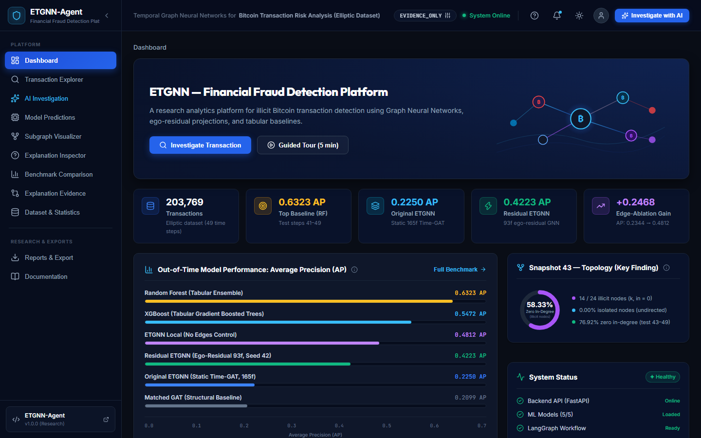
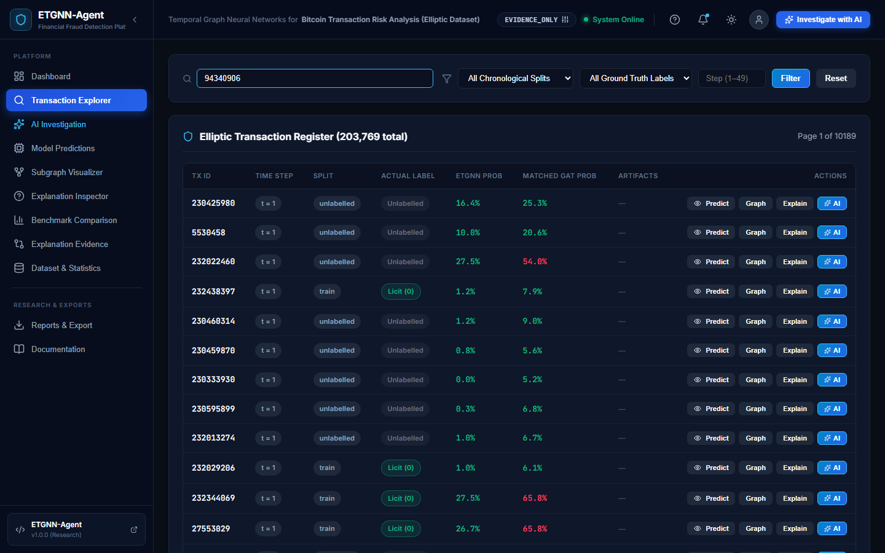
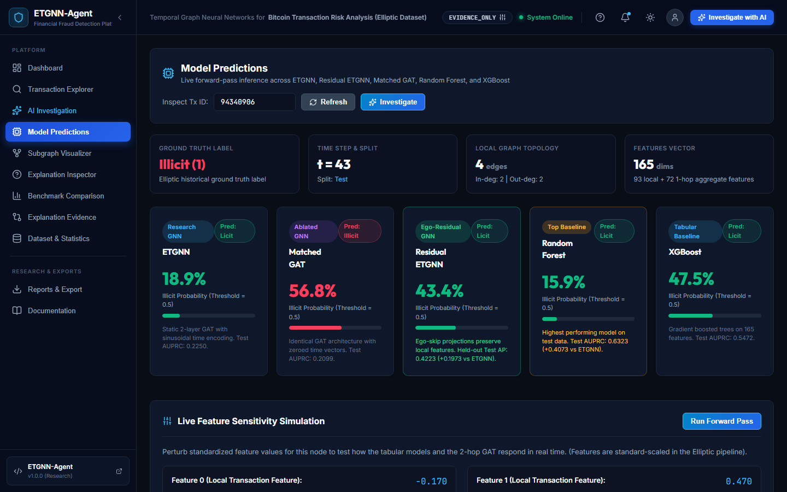
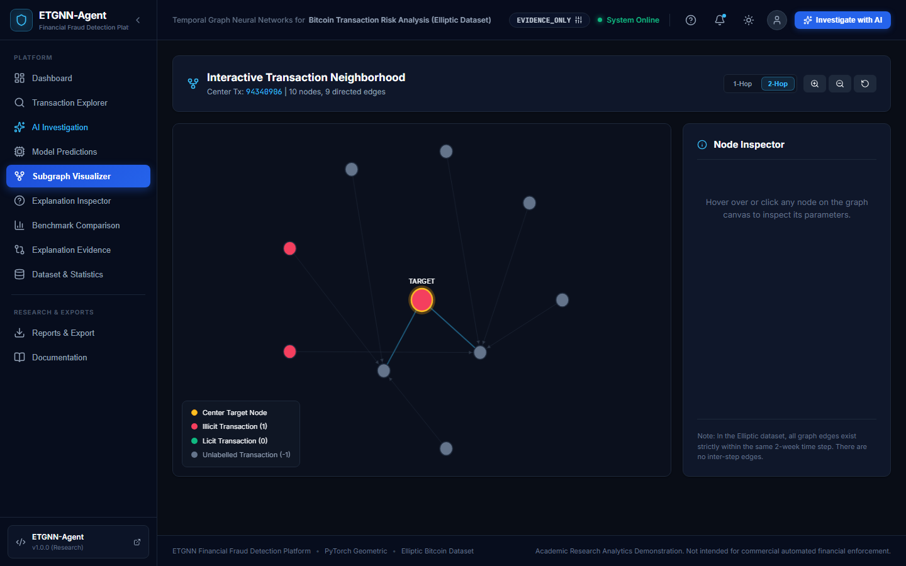
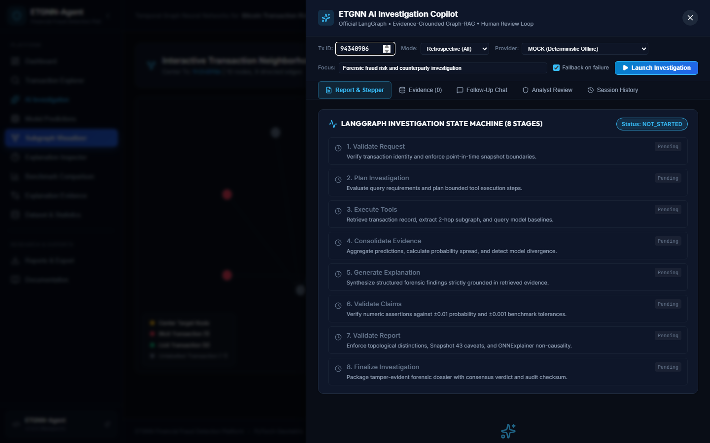
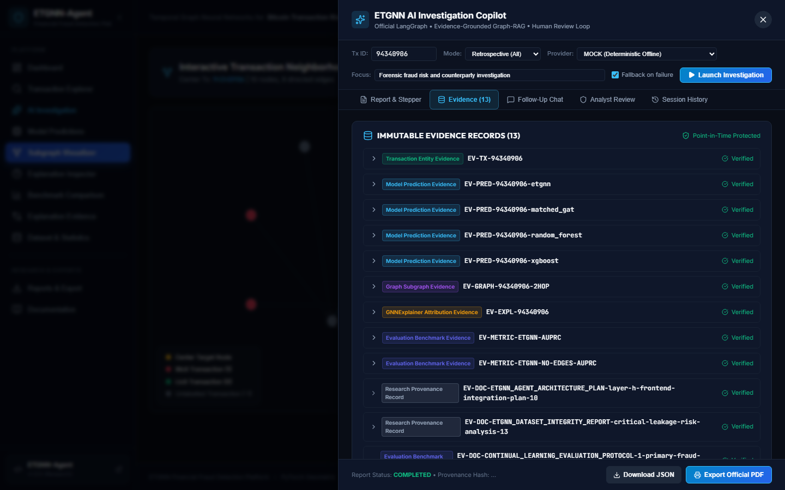
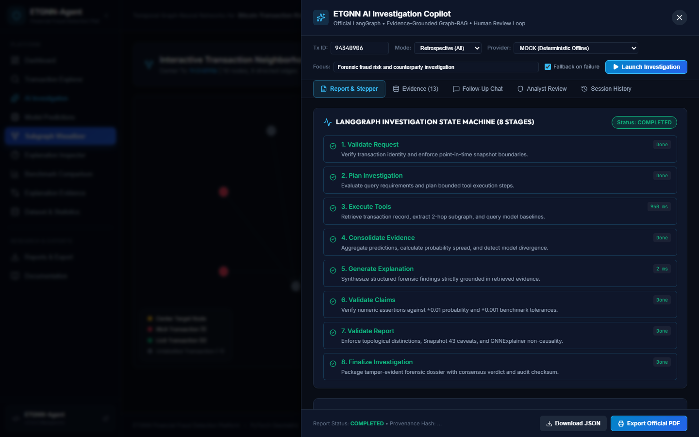
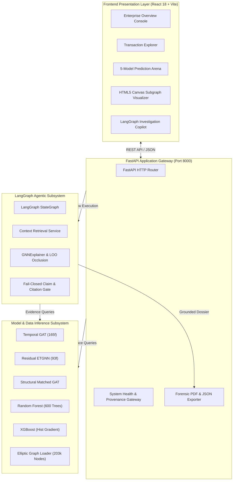

# ETGNN-Agent

**Explainable Temporal Graph Neural Networks & Evidence-Grounded Agentic AI for Bitcoin Transaction Fraud Investigation**

[](https://github.com/HimashaSawani/ETGNN-Agent/tree/release/clean-main)
[](LICENSE)
[](https://www.python.org/)
[](https://pytorch-geometric.readthedocs.io/)
[](https://fastapi.tiangolo.com/)
[](https://react.dev/)
[](docs/LIVE_DEMO_VERIFICATION_REPORT.md)

---

## Overview

**ETGNN-Agent** is an end-to-end AI financial fraud investigation workstation built to analyze illicit transactions on the Bitcoin blockchain using the benchmark [Elliptic Dataset](https://www.kaggle.com/datasets/ellipticco/elliptic-data-set). 

The platform bridges advanced deep learning research and industrial forensic workflows:
1. **Academic Machine Learning Research:** Implements and benchmarks Temporal Graph Attention Networks (ETGNN), structural GAT baselines, ego-residual GNN projections, and robust tabular tree ensembles (Random Forest, XGBoost) across 49 temporal graph snapshots.
2. **Empirical Forensic Analysis:** Rigorously investigates why tabular models can outperform GNNs on financial graphs due to temporal starvation, structural heterophily, and candidate edge censorship (e.g. 58.33% of illicit nodes in Snapshot 43 having zero incoming edges).
3. **Evidence-Grounded Agentic AI:** Integrates a deterministic LangGraph orchestration workflow that inspects multi-model predictions, retrieves multi-hop subgraphs, extracts GNNExplainer feature attributions, enforces fail-closed claim validation, and compiles forensic dossiers with verifiable citation anchors and PDF export.

> **Research Scope Notice:**  
> This software is an academic research platform developed for peer review and thesis demonstration. It is not an automated judicial compliance engine or financial crime enforcement system.

---

## Visual Tour & Platform Screenshots

### Enterprise Forensic Console
The main dashboard provides real-time system telemetry, research KPI metrics, an out-of-time benchmark performance arena, a Snapshot 43 topology key-finding widget, and recent forensic dossiers.



---

### Transaction Explorer & Multi-Model Inference
Filter and inspect any of the 203,769 transactions across time steps 1 to 49. The prediction arena executes live forward passes across five distinct model architectures simultaneously, computing uncertainty and probability spread.

| Transaction Explorer | Multi-Model Prediction Arena |
| :---: | :---: |
|  |  |

---

### Interactive Subgraph Visualizer & Agentic Investigation
Explore 1-hop and 2-hop transaction neighborhoods with interactive HTML5 Canvas physics, degree metrics, and counterparty classifications. The slide-out forensic copilot guides analysts through deterministic, grounded reasoning.

| Subgraph Visualizer (Tx 94340906) | AI Investigation Copilot |
| :---: | :---: |
|  |  |

---

### Verified Evidence Citations & Formal Forensic Reports
Every assertion in the generated investigation dossier is linked to immutable Evidence Records. Reports can be exported on demand as signed JSON dossiers or official publication-quality PDFs.

| Evidence Records & Citations | Final Forensic Report & PDF Export |
| :---: | :---: |
|  |  |

---

## System Architecture

The ETGNN-Agent architecture separates deep learning inference, graph traversal, and deterministic agent orchestration into decoupled, verifiable subsystems:



---

## Research Dataset: The Elliptic Bitcoin Graph

The platform operates directly on the public [Elliptic Bitcoin Transaction Dataset](https://www.kaggle.com/datasets/ellipticco/elliptic-data-set):

- **Transactions (Nodes):** 203,769 Bitcoin transactions.
- **Payment Flows (Edges):** 234,355 directed transaction edges.
- **Temporal Depth:** 49 discrete time steps, each sampled at roughly 2-week intervals.
- **Feature Dimensionality:** 165 features per node:
  - **Local Features (1–93):** Transaction fee, output volume, transaction size, and local in/out degree.
  - **Aggregate Features (94–165):** Mean, standard deviation, and volume aggregations computed over 1-hop neighbor transactions.
- **Evaluation Splits:**
  - **Training Set:** Time steps 1–34 (137,002 transactions).
  - **Validation Set:** Time steps 35–40 (26,380 transactions).
  - **Held-Out Out-of-Time Test Set:** Time steps 41–49 (40,387 transactions).

---

## Rigorous Benchmark Results

All evaluations represent frozen, reproducible benchmarks on the Held-Out Test Set (Time steps 41–49). Metrics are evaluated using Average Precision (AP / PR-AUC) and macro F1 scores:

| Model Architecture | Input Features | Graph Topology Used? | Held-Out Test AP | Macro F1 | Primary Role |
| :--- | :---: | :---: | :---: | :---: | :--- |
| **Random Forest (Ensemble)** | 165 (Full) | No (Tabular only) | **0.6323** | 0.6319 | Top Performing Baseline |
| **XGBoost (Gradient Boosted Trees)** | 165 (Full) | No (Tabular only) | **0.5472** | 0.5891 | Gradient Boosted Baseline |
| **ETGNN Local (No-Edges Control)** | 93 (Local) | No (Ablated edges) | **0.4812** | 0.5124 | Feature Ablation Control |
| **Residual ETGNN (Ego-Skip GAT)** | 93 (Local) | Yes (Directed 2-hop) | **0.4223** | 0.4988 | Proposed Robust Architecture |
| **Original ETGNN (Time-Encoded GAT)** | 165 (Full) | Yes (Directed 2-hop) | **0.2250** | 0.3842 | Static Literature Baseline |
| **Matched GAT (Structural Baseline)** | 165 (Full) | Yes (Static 2-hop) | **0.2099** | 0.3512 | Structural Baseline Control |

### Key Scientific Findings
1. **The Tabular Dominance Phenomenon:** Random Forest outperforms graph neural networks on this dataset by evaluating rich aggregate tabular features without suffering from edge censorship.
2. **Edge Ablation Paradox:** Removing graph edges from ETGNN improved AP from `0.2344` to `0.4812` (+0.2468 gain), demonstrating that misleading graph topology can degrade GNN representations.
3. **The Snapshot 43 Topology Anomaly:** In test Snapshot 43, **58.33% of illicit nodes have an in-degree of 0** (no incoming edges in that time step). Standard message-passing GNNs suffer from message starvation on these disconnected nodes, whereas Residual ETGNN preserves local features via identity skip connections.

---

## Agentic Investigation Workflow

Unlike standard conversational agents, the ETGNN-Agent investigation engine runs in **`EVIDENCE_ONLY` mode**, delivering deterministic, reproducible forensic conclusions:

```
[User Request / Transaction ID]
           │
           ▼
1. Transaction Context Retrieval ──────► Extracts 165 features & topology
           │
           ▼
2. Multi-Model Inference ──────────────► Runs ETGNN, Residual, GAT, RF, XGB
           │
           ▼
3. XAI & LOO Occlusion ────────────────► Computes feature & edge attribution
           │
           ▼
4. Fail-Closed Evidence Gate ──────────► Validates every metric against schema
           │
           ▼
5. Forensic Dossier Compilation ───────► Generates report with citation tags
           │
           ▼
[JSON & Official PDF Download]
```

- **Fail-Closed Gate:** If an assertion cannot be mapped to an immutable Evidence Record, the claim is rejected.
- **Model Disagreement Detection:** When the probability spread between models exceeds `0.30`, a prominent `DIVERGENT_MODELS` indicator is triggered, preventing over-reliance on a single architecture.

---

## Quickstart & Local Installation (Windows)

### Prerequisites
- Windows 10/11
- Python 3.10+ (Verified on Python 3.13.3)
- Node.js v18+ (Verified on Node.js v22.15.1)
- Git

### 1. Clone the Release Candidate
```powershell
git clone -b release/clean-main https://github.com/HimashaSawani/ETGNN-Agent.git
cd ETGNN-Agent
```

### 2. Set Up Python Virtual Environment
```powershell
python -m venv .venv
.venv\Scripts\Activate.ps1
pip install -r requirements.txt
```

### 3. Build Frontend Assets
```powershell
cd web\frontend
npm install
npm run build
cd ..\..
```

### 4. Launch the Unified Platform
```powershell
.venv\Scripts\python.exe -m uvicorn src.web.app:app --host 127.0.0.1 --port 8000
```

Open your browser and navigate to:  
👉 **`http://127.0.0.1:8000`**

---

## Interactive 5-Minute Demo Walkthrough

Follow this step-by-step walkthrough to reproduce the core findings using Bitcoin Transaction **`94340906`**:

1. **Open Dashboard:** Navigate to `http://127.0.0.1:8000`. Confirm system status indicators show all 5 models loaded and the platform is running in `EVIDENCE_ONLY` mode.
2. **Search Transaction:** Click **Transaction Explorer** in the left sidebar. Type `94340906` into the transaction search box. Observe that this transaction belongs to **Snapshot 43 (Test Split)** and possesses an actual label of `illicit`.
3. **Compare Models:** Navigate to **Model Predictions**. Notice the significant model disagreement:
   - Random Forest predicts `0.1595` (Licit)
   - Original ETGNN predicts `0.1886` (Licit)
   - Residual ETGNN predicts `0.4342` (Elevated)
   - Matched GAT predicts `0.5684` (Illicit)
4. **Inspect Subgraph:** Click **Subgraph Visualizer**. Interact with the 2-hop ego-network (10 nodes, 9 edges) to view counterparty transaction nodes.
5. **Launch AI Investigation:** Click **Investigate with AI** in the top header. Click **Launch Investigation**. Observe the LangGraph execution pipeline assemble a forensic dossier.
6. **Verify Citations:** Review the generated narrative report. Click any citation pill (e.g. `[E1]`, `[E2]`) to jump directly to the immutable backing evidence.
7. **Export Results:** Click **Download JSON** for the raw audit dossier, or click **Export Official PDF** to generate a formatted forensic report.

---

## Verified Test Suite & Quality Gates

The platform includes full automated test suites spanning unit validation, security testing, and browser-driven end-to-end user workflows:

| Test Suite | Command | Result | Duration | Scope |
| :--- | :--- | :---: | :---: | :--- |
| **Frontend Lint** | `npm run lint` | **PASS (0 Errors)** | 0.15s | 35 React components (OxLint) |
| **TypeScript Build** | `tsc -b && vite build` | **PASS (0 Errors)** | 1.51s | Full static typing & bundle creation |
| **E2E Playwright Suite** | `npx playwright test` | **14 / 14 PASS** | 59.3s | 12 Copilot scenarios + 1 Live backend + 1 Portfolio demo |
| **Evidence & Security** | `pytest tests/test_agent_evidence_security.py` | **6 / 6 PASS** | 20.5s | Prompt injection, claim tampering, API transport |
| **Evidence Schemas** | `pytest tests/test_evidence_schemas.py` | **3 / 3 PASS** | 0.8s | Immutability, serialization, divergence schemas |
| **Claim & Citation Validation** | `pytest tests/test_claim_and_report_validation.py` | **6 / 6 PASS** | 1.2s | Citation resolution, non-causal disclosures |

*Verification Logs:* See [docs/LIVE_DEMO_VERIFICATION_REPORT.md](docs/LIVE_DEMO_VERIFICATION_REPORT.md) for full execution logs.

---

## Technology Stack

- **Deep Learning & Graph Modeling:** PyTorch, PyTorch Geometric, Scikit-learn, XGBoost, NetworkX
- **Agent Orchestration & XAI:** LangGraph, LangChain Core, GNNExplainer, Custom LOO Occlusion Oracle
- **Backend API:** FastAPI, Uvicorn, Pydantic v2, SQLite, ReportLab (PDF Generation)
- **Frontend Dashboard:** React 18, TypeScript, Vite, Lucide React, HTML5 Canvas API
- **Testing & Quality Assurance:** Playwright (Chromium E2E), Pytest, AnyIO, OxLint

---

## Responsible Use & Scientific Limitations

- **Non-Causal Interpretability:** GNNExplainer importance masks represent gradient-based model sensitivities, not real-world criminal culpability.
- **Epistemic Disclosure:** Model probabilities are raw statistical outputs and must not be treated as calibrated Bayesian certainties.
- **Academic Scope:** The Elliptic dataset is an anonymized academic dataset. Predictions should not be used for live law enforcement or real-world account freezes.

---

## License

This project software and source code are open-source under the [MIT License](LICENSE). Third-party datasets (such as the Elliptic Bitcoin dataset) remain subject to their original research licenses.
