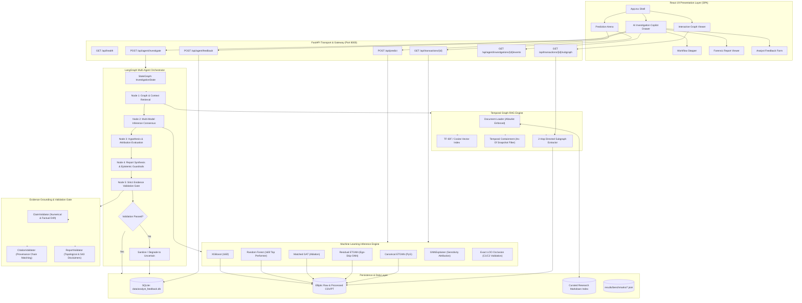

# ETGNN-Agent System Architecture Specification

## 1. High-Level Architectural Topology

---

## 2. Component Design & Inter-Module Communication

### 2.1 React 19 Frontend Layer (`web/frontend/`)
- **Technology Stack**: React 19, TypeScript ~6.0, Vite 8, Lucide-React.
- **Key Modules**:
  - `PredictionArena`: Provides side-by-side forward-pass prediction comparisons across GNNs and tree models with interactive feature override capabilities.
  - `InvestigationCopilotDrawer`: Slide-over drawer orchestrating autonomous investigation lifecycles, streaming workflow stepper status, model agreement panels, and evidence citation explorer.
  - `InteractiveGraphEvidenceViewer`: Renders candidate transaction subgraphs, highlighting directed edge flow, degree characteristics, and topological qualifications.

### 2.2 FastAPI Gateway (`src/web/app.py`)
- **Architecture**: Asynchronous ASGI application with singleton model and dataset caching (`DataLoader`).
- **Safety Boundaries**:
  - Enforces CORS policies and input validation via Pydantic schemas.
  - Serves static assets for the React SPA at `/` with clean client-side routing fallback.
  - Integrates SSE streaming telemetry for agent execution stages.

### 2.3 LangGraph Autonomous Agent (`src/agent/`)
- **Workflow State Machine**: `StateGraph` cycling through deterministic stages:
  1. `retrieve_context`: Fetches transaction metadata, directed subgraph, and research documents up to the evaluation snapshot.
  2. `model_inference`: Executes forward passes across PyG and scikit-learn models; calculates consensus and probability spread.
  3. `evaluate_hypotheses`: Compares model agreement and evaluates structured fraud hypotheses against topological evidence.
  4. `generate_report`: Compiles narrative summary, supported findings, and limitation disclosures.
  5. `validate_report`: Passes all synthesized claims and citations through the three-tier validation gate. If invalid, sanitizes and degrades claims to uncertain findings.

### 2.4 Evidence Grounding Gate (`src/agent/validation/`)
- **`ClaimValidator`**: Flags numerical drift between report claims and underlying prediction probabilities (strict tolerance $\pm 0.01$ for probabilities, $\pm 0.001$ for benchmark metrics).
- **`CitationValidator`**: Enforces strict provenance; every cited evidence ID must exist in the validated `provenance_chain`.
- **`ReportValidator`**: Enforces scientific integrity policies:
  - Distinguishes missing topology from verified zero-degree topology.
  - Enforces mandatory non-causal historical observation for Snapshot 43 transactions.
  - Requires sensitivity disclaimers on GNNExplainer attributions.

---

## 3. Data Flow & Security Containment

1. **Temporal Isolation**: No document, transaction, or edge timestamped greater than the target transaction's snapshot $t$ is accessible during inference or RAG retrieval.
2. **Fail-Closed Fallback**: In the absence of external LLM credentials (Google Gemini / Anthropic Claude), the platform automatically falls back to `EVIDENCE_ONLY` mode, generating factual reports directly from verified evidence records without hallucinated narratives.
3. **Auditability**: Every generated investigation dossier is signed with a deterministic SHA256 provenance hash linking findings to exact underlying `EvidenceRecord` IDs.

