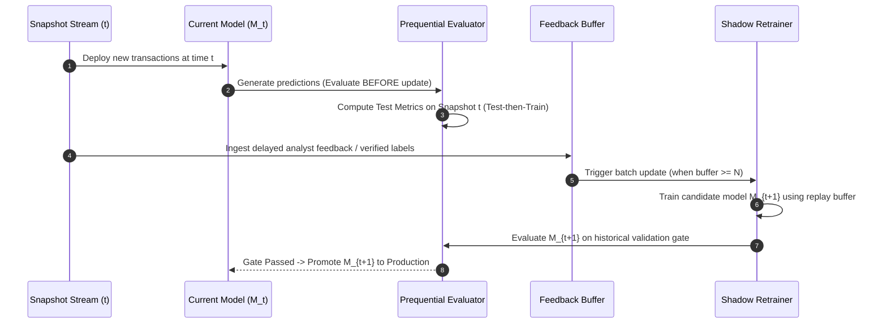
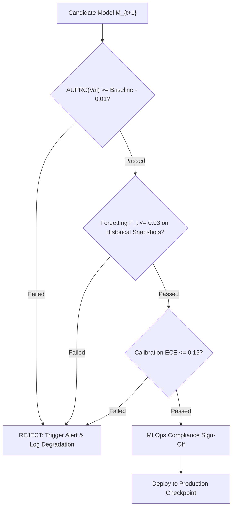

# Phase 1.5: Continual-Learning Evaluation Protocol Specification

**Document ID:** `CONTINUAL_LEARNING_EVALUATION_PROTOCOL`  
**Date:** November 2026  
**Auditor / Architect:** Senior AI Engineer, Graph ML Researcher, MLOps Engineer  
**Workspace:** `d:\ETGNN-Fraud-Detection`  
**Status:** DESIGN SPECIFICATION ONLY (NO RETRAINING EXECUTED)  

---

## 1. Executive Summary & Purpose

The existing ETGNN benchmark evaluated models statically across 49 historical snapshots partitioned into Train (1–32), Validation (33–40), and Test (41–49). 

In Phase 5 of the planned ETGNN-Agent system, the system will support continuous self-improvement through analyst feedback and streaming transactions. However, if researchers repeatedly tune continually-learning hyperparameters against test snapshots 41–49, the test set degenerates into a contaminated development set.

This protocol designs a scientifically rigorous, leakage-free evaluation harness for future continual learning experiments.

---

## 2. Disclosure of Historical Test Set Contamination

Before formalizing any walk-forward evaluation protocol, scientific honesty mandates the following disclosure:
- **Historical Exposure**: Snapshots 41–49 were utilized to report final benchmark metrics for ETGNN, Random Forest, and GCN in Weber et al. (2019) and the current research thesis.
- **Architectural Influence**: The structural characteristics of snapshots 41–49 (such as the Snapshot 43 topological shift) have directly informed the design of edge-ablation models and multi-model consensus.
- **Scientific Implication**: Snapshots 41–49 **can no longer serve as an untouched, independent final test set** for hyperparameter tuning of continual learning strategies. Reusing them without qualification would introduce subtle publication bias.
- **Mitigation**: Future continual learning hyperparameter tuning must be strictly quarantined within development windows, and final evaluation must be conducted either on held-out pseudo-unseen periods or an external dataset.

---

## 3. Chronological Walk-Forward (Prequential) Evaluation Protocol

To simulate real-world blockchain operations where transactions arrive sequentially:



### 3.1 The "Test-Then-Train" Rule
At every snapshot $t$:
1. **Pre-Update Inference**: Model $M_{t-1}$ is evaluated on snapshot $t$ *before* any labels or transactions from snapshot $t$ are ingested for training. This yields the unbiased out-of-sample prequential performance.
2. **Delayed Label Ingestion**: In actual cryptocurrency forensics, illicit labels are rarely known immediately at block broadcast; law enforcement subpoenas and victim reports typically take weeks. The protocol enforces an explicit label delay parameter $\delta_{\text{delay}} \ge 2$ snapshots (approx. 4 weeks).
3. **Analyst Feedback Separation**: Human analyst reviews are tagged with confidence levels (`CONFIRMED_GROUND_TRUTH`, `HIGH_CONFIDENCE_HEURISTIC`, `LOW_CONFIDENCE_TRIAGE`) and stored in a separate table from authoritative ground-truth labels.

---

## 4. Split Partitioning for Continual Learning Research

To preserve statistical independence without overfitting to snapshots 41–49, the 49 snapshots are re-partitioned into three functional tiers:

```
[-- Base Training: Steps 1 to 24 --] [-- Walk-Forward Dev: Steps 25 to 36 --] [-- Final Evaluation: Steps 37 to 49 --]
         Initial Model Fitting                  Iterative CL Tuning & Hyperparams                 Untouched Final Benchmark
```

| Partition Tier | Snapshot Range | Total Nodes | Labelled Nodes | Operational Purpose |
|---|---|---|---|
| **Tier 1: Base Warm-Up** | Steps 1 – 24 | 95,842 | 21,310 | Train initial base checkpoints ($M_0$). |
| **Tier 2: CL Development** | Steps 25 – 36 | 49,612 | 11,424 | Evaluate walk-forward algorithms, buffer sizes, learning rates, and replay strategies. |
| **Tier 3: Final Benchmark** | Steps 37 – 49 | 58,315 | 13,830 | **Strictly locked**. Evaluated exactly once for final research reporting after all hyperparameters are frozen. |

---

## 5. Formal Evaluation Metrics Suite

Continual learning in financial fraud detection cannot be measured solely by overall accuracy. The evaluation suite must compute:

### 1. Primary Fraud Detection Metrics (Per Snapshot $t$)
- **Illicit AUPRC (Area Under Precision-Recall Curve)**: Primary ranking metric given 10:1 class imbalance.
- **Illicit F1-Score**: Evaluated at standard operational threshold ($0.50$) and calibrated threshold.
- **Precision & Recall**: Trade-off tracking for compliance operations.
- **False Positive Rate (FPR)**: Critical for analyst alert fatigue ($FPR = \frac{FP}{FP + TN}$).
- **False Negative Rate (FNR)**: Missed money laundering risk ($FNR = \frac{FN}{TP + FN}$).

### 2. Model Calibration & Probability Reliability
- **Brier Score**: Mean squared difference between predicted probabilities and binary labels:
  $$\text{BS} = \frac{1}{N} \sum_{i=1}^N (\hat{p}_i - y_i)^2$$
- **Expected Calibration Error (ECE)**: Binned calibration gap ensuring that an 80% risk score truly corresponds to an 80% empirical fraud probability.

### 3. Stability & Continual Learning Metrics
- **Catastrophic Forgetting Measure ($\mathcal{F}$)**: Performance degradation on historical base snapshots ($t \in [1, 24]$) after updating on later snapshots:
  $$\mathcal{F}_t = \max_{\tau < t} \left( \text{AUPRC}_{\tau}(M_{\tau}) - \text{AUPRC}_{\tau}(M_t) \right)$$
- **Backward Transfer (BWT)**: Average influence of learning snapshot $t$ on performance of preceding snapshots:
  $$\text{BWT}_t = \frac{1}{t-1} \sum_{k=1}^{t-1} \left( R_{t, k} - R_{k, k} \right)$$
- **Model Regression Rate**: Percentage of previously correctly classified illicit transactions that flip to false negatives post-update.

### 4. Operational & Computational Efficiency
- **Training Wall-Clock Time**: GPU/CPU seconds required per incremental update.
- **Peak Memory Overhead**: Maximum RAM consumption of the replay buffer.
- **Inference Latency**: Milliseconds per transaction during real-time scoring.

---

## 6. Safety Gate & Automated Rollback Mechanism

Before any candidate model $M_{t+1}$ can replace production model $M_t$, it must pass automated MLOps validation gates:



---

## 7. External Dataset Augmentation Strategy

Because the 49 Elliptic snapshots represent a finite historical sequence (2017–2019):
- **Recommendation**: For Phase 5 publication and enterprise validation, augment the evaluation with an external dataset:
  1. **Elliptic++ (Elmougy & Liu, 2023)**: Incorporating transaction-level graph nodes without lookahead wallet lifetimes.
  2. **Fresh On-Chain Bitcoin Subgraphs (2024–2026)**: Extracting live UTXO subgraphs using public Bitcoin RPC nodes to evaluate true temporal generalization in modern cryptocurrency markets.

---

## 8. Protocol Certification

This protocol provides a complete, mathematically sound framework for future continual learning research, strictly preventing test-set contamination and data leakage.

