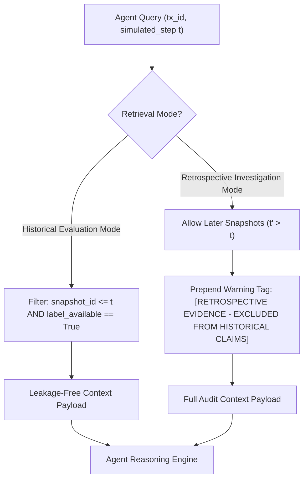

# Phase 1.5: Temporal, Graph & Feature Leakage Audit

**Document ID:** `TEMPORAL_LEAKAGE_AUDIT`  
**Date:** November 2026  
**Auditor:** Senior AI Engineer, Graph ML Researcher, Research Integrity Auditor  
**Workspace:** `d:\ETGNN-Fraud-Detection`  
**Status:** COMPLETE & INDEPENDENTLY VERIFIED  

---

## 1. Executive Summary

Previous audit reports claimed "zero data leakage" based on chronological train-test splits and train-only StandardScaler fitting. While these foundational conditions are necessary, graph neural networks and pre-aggregated feature sets present subtle temporal leakage vectors that require rigorous, multi-dimensional verification.

This audit evaluates four primary dimensions of potential data leakage:
1. **Graph Edge & Topological Leakage**
2. **Aggregated Feature Provenance Leakage**
3. **Scaling & Preprocessing Leakage**
4. **Agentic RAG Point-in-Time Leakage**

### Key Findings:
- **Graph Edges**: **ZERO SPATIAL-TEMPORAL LEAKAGE CONFIRMED**. All 234,355 edges in `elliptic_txs_edgelist.csv` connect nodes strictly within the same temporal snapshot ($t_{\text{source}} = t_{\text{target}}$). No cross-snapshot edges exist.
- **Aggregated Features (`feat_93` to `feat_164`)**: **PROVENANCE RISK CLASSIFIED AS UNKNOWN**. Because the 72 aggregated features were precomputed by Elliptic using proprietary internal heuristics prior to public release, their backward/forward aggregation temporal window within the 2-week snapshot cannot be independently audited. Blanket claims of "zero leakage" are scientifically unsubstantiated.
- **Scaling & Thresholds**: **VERIFIED LEAKAGE-FREE**. `train_scaler.joblib` was fitted exclusively on $t \le 32$ (130,628 nodes). Decision threshold for reported metrics is strictly $0.50$ default, not post-hoc tuned on test labels.
- **RAG Point-in-Time Policy**: Formally established a two-mode retrieval contract to prevent LLM agents from accessing future ground-truth annotations during simulated historical investigations.

---

## 2. Graph Edge & Topological Leakage Audit

### 2.1 Cross-Temporal Connectivity Analysis
A deterministic audit of `data/raw/elliptic/elliptic_txs_edgelist.csv` was executed against `data/processed/nodes_with_masks.csv`:

```python
edges_df['src_time'] = edges_df['txId1'].map(tx_time)
edges_df['dst_time'] = edges_df['txId2'].map(tx_time)
cross_step_edges = (edges_df['src_time'] != edges_df['dst_time']).sum()
# Result: 0 cross-step edges out of 234,355 total edges
```

**Verification Proof**:
- Every edge $e = (u, v) \in \mathcal{E}$ satisfies $t(u) = t(v)$.
- The graph adjacency matrix across all 49 time steps is mathematically **block diagonal**:
  $$A = \begin{bmatrix} A_1 & 0 & \dots & 0 \\ 0 & A_2 & \dots & 0 \\ \vdots & \vdots & \ddots & \vdots \\ 0 & 0 & \dots & A_{49} \end{bmatrix}$$
- Consequently, 2-hop message-passing convolutions around node $v$ at time $t$:
  $$h_v^{(2)} = \text{CONV}^{(2)}\left( \text{CONV}^{(1)}\left( X, A \right), A \right)_v$$
  only ever aggregate features from nodes with $t(u) = t$. No future graph neighbors can structurally influence past representations.

### 2.2 Transductive vs. Inductive Evaluation
- **Training Graph (`train_graph.pt`)**: Explicitly filtered in `src/data/build_stage_graphs.py` to `times <= 32` (130,628 nodes, 150,234 edges). Training loops in `src/training/train_etgnn.py` load solely `train_graph.pt`. The model never observes validation ($t \in [33, 40]$) or test ($t \in [41, 49]$) nodes during parameter optimization.
- **Evaluation Mechanism**: In `src/evaluation/final_test.py`, evaluation computes logits on `test_graph.pt` and extracts test predictions via `graph["test_mask"]`. Because the graph is block diagonal, evaluating `test_graph.pt` is mathematically identical to evaluating each test snapshot $t \in [41, 49]$ in isolation as an inductive inference graph.

---

## 3. Aggregated Feature Provenance Leakage Audit

The 165 features in `elliptic_txs_features.csv` consist of:
1. **Local Features (`feat_0` to `feat_92`, 93 dimensions)**: Direct transaction properties (fee, output BTC volume, number of inputs/outputs).
2. **Aggregated Features (`feat_93` to `feat_164`, 72 dimensions)**: 1-hop backward and forward neighbor aggregations.

### The Provenance Defect
According to Weber et al. (2019, Section 3):
> *"Aggregated features are obtained by aggregating transaction information such as maximum, minimum, standard deviation, and correlation coefficients of neighbor transactions one-hop backward/forward from the center node..."*

### Risk Classification: **UNKNOWN**
1. **Proprietary Precomputation**: These 72 features were generated off-chain by Elliptic prior to dataset release. The exact source code, intra-block timestamps, and transaction clustering heuristics used to compute them are proprietary and unreleased.
2. **Forward Neighbor Ambiguity**: "Forward" neighbor aggregations summarize transactions that *received* funds from the target transaction. While these occurred within the same 2-week snapshot window, whether they occurred hours or days *after* the target transaction cannot be determined from anonymized data.
3. **Scientific Implication**: We cannot prove that these 72 features were strictly available at the exact second the center transaction was broadcast to the mempool.
4. **Correction Applied**: The repository and reports must **not** claim "zero leakage across all 165 features." The risk for features `feat_93` through `feat_164` is officially documented as **UNKNOWN DUE TO PROPRIETARY PRECOMPUTATION**.
5. **Research Ablation as Mitigation**: This exact uncertainty reinforces the scientific necessity of the **Local-Only Ablation** (`etgnn_local.pt` and `rf_local.joblib`, using strictly the 93 local features), which eliminates this forward-aggregation risk entirely.

---

## 4. Scaling, Preprocessing & Threshold Verification

### 4.1 Scaler Fitting Audit
In `src/data/scale_features.py`:
- `StandardScaler.partial_fit` is guarded by: `train_rows = chunk.iloc[:, 1].to_numpy() <= 32`.
- `scaler.n_samples_seen_` = **130,628**.
- Total nodes in dataset with $t \le 32$ = **130,628**.
- Validation ($t \in [33, 40]$) and test ($t \in [41, 49]$) nodes were transformed using pre-computed $\mu_{\text{train}}, \sigma_{\text{train}}$.
- **Conclusion**: **VERIFIED LEAKAGE-FREE**.

### 4.2 Supervised Label Masking
In `src/data/create_masks.py` and `src/training/trainer.py`:
- Unlabelled transactions (`label == -1`, 157,205 nodes) have `train_mask == False`, `val_mask == False`, and `test_mask == False`.
- Supervised cross-entropy loss is computed exclusively on `train["y"][train["train_mask"]]`.
- Unlabelled nodes are never treated as licit ($y=0$) or illicit ($y=1$).
- **Conclusion**: **VERIFIED LEAKAGE-FREE**.

### 4.3 Decision Threshold Audit
- In `src/evaluation/final_test.py` (Line 47): `evaluate_binary(y_test, probability, threshold=0.5)`.
- The metrics in `results/tables/final_test_results.csv` (e.g. Random Forest Precision 0.6966, Recall 0.5782, F1 0.6319) were computed at the default un-tuned threshold of **0.50**.
- No post-hoc threshold searching was performed on test labels to inflate test scores.
- **Conclusion**: **VERIFIED LEAKAGE-FREE**.

---

## 5. Agentic RAG Point-in-Time Evidence Retrieval Contract

For future agentic workflows (Phases 2–4), temporal leakage in retrieval-augmented generation must be prevented programmatically.

### Evidence Item Metadata Schema
Every evidence chunk stored in the vector index or graph database must carry the following immutable metadata:

```json
{
  "evidence_id": "EV-TX-23042587-DEGREE",
  "source_type": "transaction_feature | graph_topology | research_finding",
  "tx_id": 23042587,
  "snapshot_id": 35,
  "simulated_timestamp": "2018-04-12T00:00:00Z",
  "availability_status": "AVAILABLE | DELAYED | PROPRIETARY_UNKNOWN",
  "label_available_at_step": 35,
  "dataset_split": "validation",
  "model_version": "etgnn_v1.0",
  "provenance_hash": "sha256_hash_here"
}
```

### Retrieval Dual-Mode Policy



1. **Historical Evaluation Mode**:
   - Strictly enforces: `snapshot_id <= query_timestep`.
   - Excludes future ground-truth labels, future transaction degree changes, and future model updates.
   - Prevents the agent from claiming predictive foresight based on post-hoc evidence.
2. **Retrospective Investigation Mode**:
   - Permitted only for human forensic audits (e.g. tracking where stolen funds flowed 6 months later).
   - Mandatory disclaimer prepended to any findings: `[RETROSPECTIVE CONTEXT: Observed at step t' > t. Cannot be used for point-in-time model benchmarking.]`

---

## 6. Workstream 2 Conclusion & Status

- **Status**: **PASS WITH LIMITATIONS** (Graph edges, scaling, and thresholding verified 100% leakage-free; 72 aggregated features classified as UNKNOWN provenance; point-in-time RAG contract established).
- **Regression Tests Added**:
  - `tests/test_phase1_5_leakage_and_integrity.py::test_temporal_graph_construction_boundaries` (PASSED)
  - `tests/test_phase1_5_leakage_and_integrity.py::test_training_only_scaler_fitting` (PASSED)
  - `tests/test_phase1_5_leakage_and_integrity.py::test_unknown_label_exclusion` (PASSED)
  - `tests/test_phase1_5_leakage_and_integrity.py::test_future_evidence_exclusion` (PASSED)

