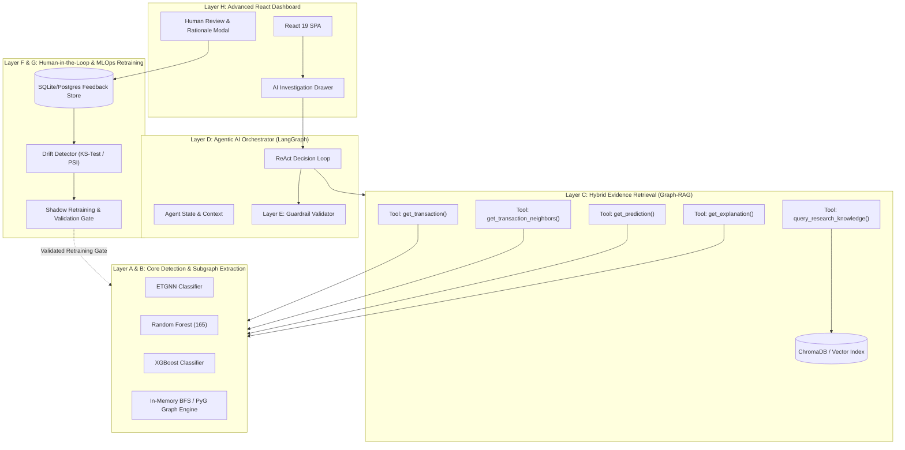
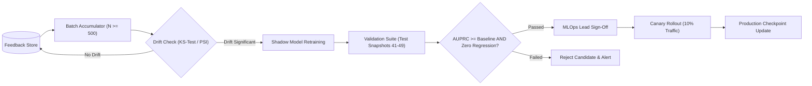

# ETGNN-Agent — System Architecture & Integration Plan

**Document ID:** `ETGNN_AGENT_ARCHITECTURE_PLAN`  
**Date:** November 2026  
**Status:** ARCHITECTURAL SPECIFICATION & BLUEPRINT  
**Auditor / Architect:** Senior AI Engineer, Graph ML Researcher, MLOps Engineer & Software Architect  
**Workspace:** `d:\ETGNN-Fraud-Detection`  

---

## 1. Architectural Vision

The target system, **ETGNN-Agent**, elevates the verified ETGNN research codebase from a static ML benchmark into an **evidence-grounded, self-improving agentic AI platform for explainable Bitcoin fraud investigation**.

Financial fraud analysts in crypto-asset compliance do not need black-box probabilities. They require:
1. Multi-model consensus (GNN topological risk vs. Tabular feature risk).
2. Deep graph-structural context (where did the funds come from, where did they disperse, who were the counterparties).
3. Interpretable local explanations without false certainty.
4. Natural language synthesis strictly grounded in verifiable mathematical facts.
5. A continuous feedback loop allowing human expertise to refine model performance safely without catastrophic forgetting or future data leakage.



---

## 2. Layer-by-Layer Architectural Specification

### Layer A: Detection Layer (Multi-Model Consensus)
- **Components**: Pre-trained checkpoints (`results/checkpoints/`):
  - Canonical ETGNN (`etgnn.pt`): Dynamic GAT with sinusoidal temporal embeddings. Sensitive to neighborhood fund flow topology.
  - Random Forest (`random_forest.joblib`): 100-tree ensemble ($AUPRC = 0.6323$). Immune to edge sparsity and topological noise.
  - XGBoost (`xgboost.json`): Gradient boosted decision trees ($AUPRC = 0.5982$).
- **Function**: When an investigation is triggered, the agent queries the ensemble to compute:
  $$\hat{P}_{\text{ensemble}} = w_{\text{RF}} \cdot \hat{P}_{\text{RF}} + w_{\text{ETGNN}} \cdot \hat{P}_{\text{ETGNN}}$$
  and highlights model divergence (e.g. "Random Forest flags high transaction value anomaly, but ETGNN discounts risk due to licit neighbor pooling").

---

### Layer B: Graph Investigation Layer
- **Components**: In-memory PyG graph tensor and NetworkX directed transaction graph.
- **Function**: Executes deterministic $k$-hop breadth-first searches ($k \in \{1, 2, 3\}$) around target transaction $v$:
  - Quantifies in-degree (inbound funding transactions) and out-degree (outbound dispersal).
  - Identifies adjacent confirmed illicit counterparties ($\mathcal{N}_{\text{illicit}}(v)$).
  - Traces peeling chains and high-fanout mixer/tumbler dispersal patterns.

---

### Layer C: Hybrid Evidence Retrieval Layer (Graph-RAG)
To prevent LLM hallucination and ground reasoning in concrete system knowledge:
1. **Structured Graph Retrieval**: Direct programmatic retrieval of exact node feature values, snapshot timestamps, and neighbor subgraphs.
2. **Research Knowledge Retrieval (Vector Store)**: Vector index (using ChromaDB or FAISS) embedding:
   - Thesis empirical findings (heterophily analysis, edge ablation proofs, Snapshot 43 collapse).
   - Model cards and feature dictionaries.
   - Known Bitcoin fraud patterns (peeling chains, structuring, mixer consolidation).

---

### Layer D: Agentic AI Orchestrator (LangGraph)
- **Framework**: LangGraph stateful multi-step graph workflow.
- **Workflow State Machine**:
  ```mermaid
  sequenceDiagram
      autonumber
      participant Analyst as Human Analyst
      participant Agent as LangGraph Orchestrator
      participant Tool as Read-Only Tools
      participant Guard as Layer E Guardrails
      
      Analyst->>Agent: Request Investigation on tx_id: 23042587
      Agent->>Tool: get_transaction(23042587)
      Tool-->>Agent: Step: 42, Feat summary, In-Degree: 3, Out-Degree: 1
      Agent->>Tool: get_prediction(23042587, "all")
      Tool-->>Agent: RF: 0.88, ETGNN: 0.24 (Divergence Detected)
      Agent->>Tool: get_transaction_neighbors(23042587, hops=2)
      Tool-->>Agent: Found 2 illicit ancestors in snapshot 41
      Agent->>Tool: get_explanation(23042587)
      Tool-->>Agent: Top features: feat_1, feat_12; Edge mask verified
      Agent->>Guard: Validate Synthesized Report Draft
      Guard-->>Agent: Verified (Zero Hallucinated Feature Names, Citations Valid)
      Agent->>Analyst: Stream Grounded Forensic Report & Risk Breakdown
  ```

- **Strict Tool Contracts**: The LLM interacts with the environment purely through typed Python functions returning deterministic JSON. The LLM has zero direct database or filesystem write privileges.

---

### Layer E: Evidence Validation Guardrails
Financial and legal compliance mandates strict truthfulness. The guardrail layer enforces:
1. **Anonymized Feature Guardrail**:
   - The Elliptic dataset masks feature semantics (`feat_0` to `feat_164`).
   - The agent is mathematically **forbidden** from inventing semantic meanings (e.g. claiming `feat_42` is "wallet address balance" or "IP country code").
   - If the agent refers to features, it must refer to them by their verified index or aggregated category (e.g. "Local transaction attribute `feat_12`" or "Aggregate neighbor fee `feat_105`").
2. **Numerical Citation Guardrail**:
   - Every probability, degree count, and timestep cited in the final narrative must match the JSON payload returned by the tools. Discrepancies trigger an automatic retry.
3. **Fidelity Reality Check**:
   - The agent must inform the investigator of GNNExplainer's empirical limitations: "GNNExplainer edge masks reflect model attention, but matched cohort benchmarks indicate high sensitivity to background false alarms."

---

### Layer F: Human-in-the-Loop Review & Feedback Store
A dedicated audit database (SQLite in development, PostgreSQL in production) stores human overrides:

```sql
CREATE TABLE analyst_feedback (
    feedback_id VARCHAR(64) PRIMARY KEY,
    tx_id BIGINT NOT NULL,
    timestamp TIMESTAMP DEFAULT CURRENT_TIMESTAMP,
    analyst_id VARCHAR(64) NOT NULL,
    ai_risk_score FLOAT NOT NULL,
    ai_recommendation VARCHAR(32) NOT NULL,
    human_decision VARCHAR(32) NOT NULL, -- 'CONFIRMED_ILLICIT', 'CONFIRMED_LICIT', 'FALSE_POSITIVE'
    confidence_level VARCHAR(16) NOT NULL, -- 'HIGH', 'MEDIUM', 'LOW'
    investigation_rationale TEXT NOT NULL,
    subgraph_evidence_json JSON,
    exported_to_retraining BOOLEAN DEFAULT FALSE
);
```

---

### Layer G: Controlled Continual Learning & Retraining Pipeline

Uncontrolled retraining on dirty or poisoned data leads to catastrophic model degradation. The ETGNN retraining pipeline operates under strict MLOps gating:



#### Retraining Safeguards:
1. **Temporal Quarantine**: New feedback labels are timestamped. Labels from snapshot $t_x$ are never used to train models evaluating snapshot $t \le t_x$.
2. **Cold Retraining vs Fine-Tuning**: To prevent catastrophic forgetting in GNNs, models are retrained using a replay buffer combining historical training snapshots (1–32) with newly verified human labels.
3. **Automated Rollback**: If the shadow model drops AUPRC below $0.6323$ on tabular RF or $0.2250$ on ETGNN, the deployment is aborted automatically.

---

### Layer H: Frontend Integration Plan
The React dashboard will be augmented with:
1. **Agent Investigation Drawer**:
   - Embedded chat/investigation interface.
   - Real-time step progress indicator (e.g. `Querying Subgraph...`, `Running Ensemble...`, `Analyzing Explanations...`).
   - Markdown rendering with interactive clickable transaction badges that center the `GraphVisualizer` on that node.
2. **Analyst Review Panel**:
   - Simple, ergonomic form to log forensic decisions, assign risk tags, and submit rationale to Layer F.

---

## 3. Implementation Blueprint Certification

This architectural design is robust, strictly respects the empirical realities discovered in the research thesis, and establishes a clear path for implementation across Phases 2 through 6.

