# ETGNN-Agent — Implementation Roadmap (Phases 2 through 6)

**Document ID:** `ETGNN_PHASE2_TO_PHASE6_ROADMAP`  
**Date:** November 2026  
**Status:** ACTIONABLE IMPLEMENTATION ROADMAP  
**Auditor / Architect:** Senior AI Engineer, Graph ML Researcher, MLOps Engineer & Software Architect  
**Workspace:** `d:\ETGNN-Fraud-Detection`  

---

## 1. Roadmap Overview & Phased Milestones

This document provides the definitive implementation plan to evolve the existing verified ETGNN research codebase into **ETGNN-Agent**.

Each phase is self-contained with explicit prerequisites, reusable files, new files to create, external dependencies, testing strategies, deliverables, acceptance criteria, and effort estimations.

```mermaid
gantt
    title ETGNN-Agent Implementation Phases
    dateFormat  X
    axisFormat  Day %d
    
    section Phase 1 (Complete)
    Codebase Audit & Architecture Blueprint :active, p1, 0, 1
    
    section Phase 2
    Evidence Retrieval & Graph-RAG Engine    :p2, 1, 3
    
    section Phase 3
    Agentic Orchestrator & Guardrails       :p3, 3, 5
    
    section Phase 4
    Full-Stack React Dashboard Integration   :p4, 5, 7
    
    section Phase 5
    Human Feedback & Safe MLOps Retraining   :p5, 7, 9
    
    section Phase 6
    Benchmarking, Documentation & Release    :p6, 9, 10
```

---

## 2. Detailed Work Breakdown by Phase

### Phase 2: Evidence Retrieval & Graph-RAG Engine

- **Primary Objective**: Construct the deterministic graph query engine, tool interfaces, and research vector knowledge base that ground agent reasoning.
- **Files to Reuse**:
  - `src/web/data_loader.py` (core data loader and model inference routines)
  - `data/processed/nodes_with_masks.csv` and `elliptic_txs_edgelist.csv`
  - `results/checkpoints/*` (all 11 verified checkpoints)
  - `thesis/Thesis_Evidence_Mapping.md` and `results/tables/final_test_results.csv`
- **Proposed New Files**:
  - `src/agent/tools/transaction_tools.py` — Deterministic Python functions for transaction lookups, $k$-hop subgraphs, and model predictions.
  - `src/agent/tools/knowledge_tools.py` — Vector retrieval interface over thesis research documents and feature dictionaries.
  - `src/agent/rag/vector_store.py` — ChromaDB / FAISS index manager for empirical research findings.
  - `scripts/build_research_index.py` — CLI script to parse markdown/CSV research artifacts into vector chunks.
  - `tests/test_agent_tools.py` — Pytest suite verifying tool schemas and return contracts.
- **External Dependencies**:
  - `chromadb` or `faiss-cpu`, `langchain-core`, `pydantic`
- **Testing Strategies**:
  - Unit tests verifying that tool outputs strictly match underlying DataFrame rows.
  - Edge-case testing for isolated nodes ($k=0$) and snapshot boundary transitions.
- **Deliverables & Acceptance Criteria**:
  - All 6 tools functional and callable from Python.
  - Vector search returns relevant research context (e.g. searching "Snapshot 43" returns the darknet takedown explanation).
  - 100% test pass rate in `tests/test_agent_tools.py`.
- **Estimated Effort**: 2 Engineering Days.

---

### Phase 3: Agentic Transaction Investigation & Guardrails

- **Primary Objective**: Build the LangGraph stateful multi-step agent orchestrator equipped with Layer E evidence validation guardrails.
- **Files to Reuse**:
  - `src/agent/tools/*` (built in Phase 2)
  - `src/explain/gnn_explainer.py` (explanation engine)
- **Proposed New Files**:
  - `src/agent/orchestrator.py` — LangGraph state machine (Investigation State, Plan, Tool Execution, Synthesis).
  - `src/agent/prompts.py` — System prompts with strict anti-hallucination rules (no synthetic feature naming).
  - `src/agent/guardrails.py` — Layer E validation filter ensuring numbers and feature names strictly match tool payloads.
  - `src/agent/schemas.py` — Pydantic models for structured investigation outputs (`InvestigationReport`, `RiskFactor`, `CounterpartySummary`).
  - `tests/test_agent_orchestrator.py` — Red-teaming and prompt-injection regression tests.
- **External Dependencies**:
  - `langgraph`, `langchain-google-genai` (or `langchain-anthropic` / `langchain-openai`)
- **Testing Strategies**:
  - Synthetic adversarial evaluation: Prompting the agent to claim `feat_42` means "account balance" and asserting that the guardrail halts and rewrites the claim.
  - Multi-hop tracing verification: Validating that illicit counterparties in subgraphs are accurately reported.
- **Deliverables & Acceptance Criteria**:
  - Agent successfully completes autonomous investigation of known illicit test transactions (e.g., in snapshots 41–49).
  - Zero hallucinated feature semantics.
  - Structured output complies 100% with `InvestigationReport` schema.
- **Estimated Effort**: 2.5 Engineering Days.

---

### Phase 4: Full-Stack React Dashboard Integration

- **Primary Objective**: Integrate the AI agent and forensic investigation reporting into the React dashboard.
- **Files to Reuse**:
  - `web/frontend/src/App.tsx` (main SPA shell)
  - `web/frontend/src/components/GraphVisualizer.tsx`
  - `web/frontend/src/components/TransactionExplorer.tsx`
  - `src/web/app.py` (FastAPI backend)
- **Proposed New Files**:
  - Backend: `src/web/routes/agent_routes.py` — Streaming SSE / WebSocket endpoint `/api/agent/investigate`.
  - Frontend: `web/frontend/src/components/AgentInvestigationDrawer.tsx` — Slide-over AI copilot drawer.
  - Frontend: `web/frontend/src/components/InvestigationReportView.tsx` — Structured report renderer with clickable transaction badges.
  - Frontend: `web/frontend/src/components/AnalystFeedbackModal.tsx` — Human review and label entry modal.
- **External Dependencies**:
  - Backend: `sse-starlette`
  - Frontend: `react-markdown`, `canvas-confetti` (for feedback celebration)
- **Testing Strategies**:
  - End-to-end user workflow: Search transaction $\to$ Click "Investigate with AI" $\to$ Observe real-time tool logs $\to$ Click badge in report $\to$ Graph centers on neighbor.
  - Responsive layout validation across desktop viewports.
- **Deliverables & Acceptance Criteria**:
  - Smooth streaming UI updates with zero layout thrashing.
  - Cross-component synchronization between Agent Drawer and Graph Visualizer.
  - Frontend build completes with 0 errors.
- **Estimated Effort**: 2 Engineering Days.

---

### Phase 5: Human-in-the-Loop Feedback & Safe Retraining Pipeline

- **Primary Objective**: Establish the SQLite/PostgreSQL feedback store and automated drift-aware MLOps retraining pipeline with safety rollback gates.
- **Files to Reuse**:
  - `src/training/trainer.py`
  - `src/evaluation/metrics.py`
  - `data/processed/train_scaler.joblib`
- **Proposed New Files**:
  - `src/feedback/database.py` — SQLAlchemy ORM schema for analyst overrides and rationales.
  - `src/mlops/drift_detector.py` — Kolmogorov-Smirnov test and Population Stability Index (PSI) calculator.
  - `src/mlops/shadow_trainer.py` — Offline retraining orchestrator with replay buffers.
  - `src/mlops/validation_gate.py` — Automated verification harness preventing regression on historical test snapshots.
  - `tests/test_feedback_pipeline.py` — Unit tests for label ingestion and drift triggers.
- **External Dependencies**:
  - `sqlalchemy`, `scipy`
- **Testing Strategies**:
  - Simulated feedback injection: Feed 100 synthetic labels, verify database persistence.
  - Regression testing: Trigger shadow retraining, deliberately inject perturbed weights, and assert that the `validation_gate` rejects the checkpoint and prevents production deployment.
- **Deliverables & Acceptance Criteria**:
  - Analyst feedback persists reliably with audit logs.
  - Automated drift detection flags statistical distribution shifts.
  - Retraining gate successfully protects baseline metrics ($AUPRC \ge 0.6323$ for RF, $\ge 0.2250$ for ETGNN).
- **Estimated Effort**: 2 Engineering Days.

---

### Phase 6: Research Benchmarking, Portfolio Packaging & Release

- **Primary Objective**: Produce comprehensive reproducibility documentation, benchmark analyst efficiency gains, and package the repository for open-source / enterprise portfolio release.
- **Files to Reuse**:
  - All Phase 1–5 documentation and artifacts.
- **Proposed New Files**:
  - `docs/REPRODUCIBILITY_GUIDE.md` — One-command reproduction guide (Docker + Conda/Venv).
  - `docs/AGENT_EVALUATION_REPORT.md` — Comparative benchmark evaluating agent-assisted investigation time vs. manual investigation.
  - `docker-compose.yml` & `Dockerfile` — Production containerization for backend and frontend.
  - `demo/sample_investigation_recordings/` — Video walkthroughs and case study briefs.
- **Deliverables & Acceptance Criteria**:
  - Clean, one-click `docker compose up` launch.
  - Comprehensive research documentation suitable for journal / conference submission or industrial presentation.
- **Estimated Effort**: 1.5 Engineering Days.

---

## 3. Implementation Prerequisites Before Launching Phase 2

Before initiating Phase 2 implementation, the following operational requirements must be satisfied:
1. **LLM Provider API Key Selection**: Choose provider for LangGraph agent (e.g. Gemini 1.5 Pro, Claude 3.5 Sonnet, or local Ollama/Llama 3).
2. **Phase 1 User Approval**: Formal user confirmation that Phase 1 audit reports are accepted and authorization to proceed to Phase 2 is granted.

