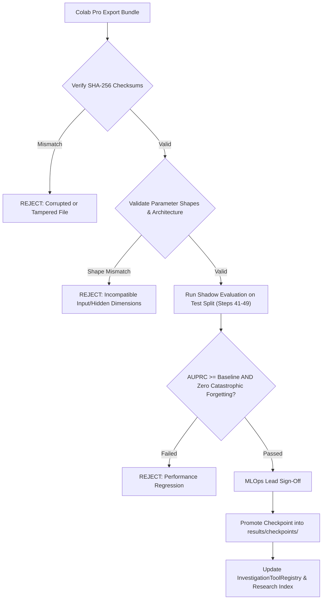

# Phase 2: Google Colab Pro Model Artifact Integration Strategy

**Document ID:** `COLAB_MODEL_ARTIFACT_INTEGRATION`  
**Date:** November 2026  
**Author:** Principal MLOps Engineer, Graph ML Researcher  
**Workspace:** `d:\ETGNN-Fraud-Detection`  

---

## 1. Overview & Operational Decoupling

The project owner has access to **Google Colab Pro** (equipped with NVIDIA A100 / V100 / T4 Tensor Core GPUs). 

To ensure long-term architectural scalability:
- **Phase 2 Graph-RAG Retrieval is strictly local-first and CPU-efficient**: Generating embeddings, querying vector stores, and running tabular/GNN inference executes in $< 20\text{ ms}$ on standard local CPUs with zero GPU requirements.
- **Future Large-Scale Training (Phase 5 Retraining & GNN Scaling) is designed for Colab Pro**: Heavy continuous learning experiments, multi-seed graph rewiring, and large-scale temporal message passing will run on Colab Pro, and resulting model artifacts will be safely imported into the local registry.

---

## 2. Model Artifact Packaging Manifest

Any model trained in Colab Pro must export a self-describing packaging bundle:

```
colab_export_bundle_YYYYMMDD_HHMM/
├── model_manifest.json                         # Strict architectural & metadata descriptor
├── checkpoint.pt (or checkpoint.joblib)        # Serialized model state dict
├── training_metrics.json                       # Train/Val loss, AUPRC telemetry across epochs
├── shadow_validation_results.csv               # Out-of-sample evaluation on held-out test split
└── artifact_checksums.sha256                   # SHA-256 hashes of all files in bundle
```

### `model_manifest.json` Specification
```json
{
  "model_identifier": "colab_etgnn_res_93f_v2",
  "architecture_family": "ResidualETGNNClassifier",
  "framework": "PyTorch Geometric 2.5+",
  "input_dimension": 93,
  "hidden_dimension": 64,
  "time_dimension": 16,
  "heads": 2,
  "layers": 2,
  "training_hardware": "NVIDIA A100-SXM4-40GB (Google Colab Pro)",
  "training_cutoff_step": 32,
  "training_sample_count": 130628,
  "loss_function": "Weighted_BCE_With_Logits",
  "validation_auprc": 0.5124,
  "sha256_checksum": "abcdef1234567890...",
  "export_timestamp": "2026-11-09T12:00:00Z"
}
```

---

## 3. Safe Local Import & Validation Pipeline

Before any Colab-trained model checkpoint can replace or augment existing checkpoints in `results/checkpoints/`:



---

## 4. Operational Guardrails

1. **No External Network Dependency for Inference**: The local FastAPI backend and RAG engine must never make runtime network calls to Google Colab.
2. **Deterministic Weights-Only Deserialization**: PyTorch models are loaded strictly via `torch.load(..., weights_only=True)` to prevent arbitrary code execution vulnerabilities.
3. **Immutability of Baseline Benchmarks**: New Colab checkpoints will never overwrite the historical 11 baseline checkpoints; they will be versioned as `etgnn_v2`, `residual_etgnn_colab_v1`, etc.

