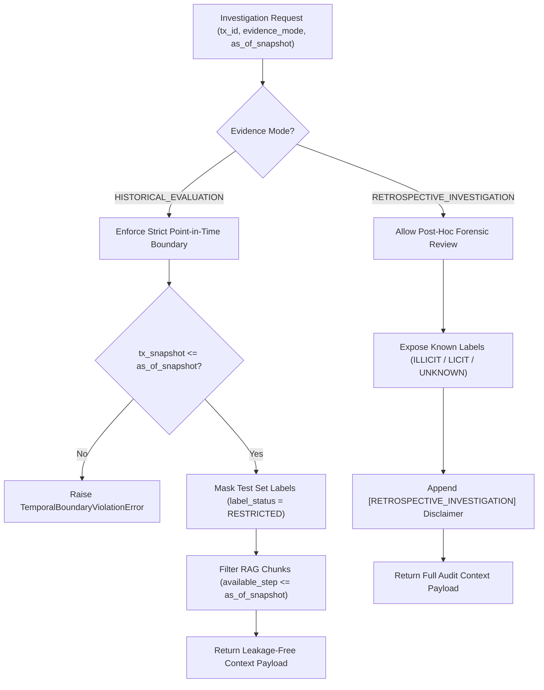

# Phase 2: Point-in-Time Evidence Retrieval Policy

**Document ID:** `POINT_IN_TIME_RETRIEVAL_POLICY`  
**Date:** November 2026  
**Author:** Principal AI Engineer, MLOps Engineer, Research Integrity Auditor  
**Workspace:** `d:\ETGNN-Fraud-Detection`  

---

## 1. The Point-in-Time Imperative

In simulated historical evaluations of financial fraud models, **lookahead leakage** is the most pervasive flaw. If a model or agent evaluating a transaction at simulated snapshot $t$ accesses:
- A ground-truth fraud label determined months later,
- Graph edges created in snapshot $t' > t$, or
- A research finding that analyzed future test set distributions,

the resulting performance claims are scientifically invalid and fundamentally deceptive.

Phase 2 enforces a strict, programmatic **Point-in-Time Access Control Policy**.

---

## 2. Dual-Mode Retrieval Architecture



---

## 3. Mode Specifications & Invariants

### 3.1 HISTORICAL_EVALUATION Mode (Default for Benchmarking)
- **Primary Objective**: Accurately simulate the exact information available to a compliance analyst or automated detector at the moment the transaction occurred.
- **Invariants Enforced**:
  1. **Strict Timestamp Rejection**: If `as_of_snapshot` is specified and the target transaction has `time_step > as_of_snapshot`, the tool immediately raises:
     ```python
     raise TemporalBoundaryViolationError(f"Transaction {tx_id} belongs to snapshot {tx_step}, which is in the future relative to requested as_of_snapshot {as_of_snapshot}.")
     ```
  2. **Test Label Masking**: Transactions in the test partition ($t \in [41, 49]$) have their ground truth labels masked (`label_status = LabelStatus.RESTRICTED`, `raw_label_code = None`).
  3. **Neighbor Filtering**: Subgraph traversals only expose neighbor transactions within the simulated temporal horizon.
  4. **Fail-Closed Missing Availability**: If an evidence document has no established `available_as_of_step`, it is excluded from historical retrieval.

### 3.2 RETROSPECTIVE_INVESTIGATION Mode (Forensic Audit Mode)
- **Primary Objective**: Allow human compliance officers to conduct post-hoc forensic audits (e.g. tracing where stolen Bitcoin flowed across months of subsequent transactions).
- **Invariants Enforced**:
  1. **Ground Truth Disclosure**: Displays verified labels (`ILLICIT`, `LICIT`, or `UNKNOWN`).
  2. **Mandatory Audit Disclaimer**: Injects explicit warning into limitations:
     `"RETROSPECTIVE_INVESTIGATION mode: Ground truth displayed for post-hoc forensic review. Must not be used for historical predictive benchmarking."`
  3. **Unknown Label Preservation**: Transactions with code `-1` remain `LabelStatus.UNKNOWN`—they are NEVER converted to licit.

---

## 4. Feature Space Point-in-Time Provenance Classification

As established in the Phase 1.5 audit, the 165 features are partitioned by point-in-time confidence:

| Feature Subset | Feature Count | Verified Point-in-Time Status | Policy Enforcement |
|---|---|---|---|
| **Local Features (`feat_0`–`feat_92`)** | 93 | **VERIFIED POINT-IN-TIME SAFE** | Available for all point-in-time historical evaluations. Derived directly from transaction header and inputs/outputs. |
| **Aggregated Features (`feat_93`–`feat_164`)** | 72 | **PROVENANCE UNKNOWN** | Precomputed off-chain by Elliptic. Tagged with an explicit epistemic disclaimer regarding forward 1-hop aggregation windows. |
| **Local Ablation (`etgnn_local`, `rf_local`)** | 93 | **LEAKAGE-FREE BENCHMARK CONTROL** | Evaluated on strictly the 93 local features, providing a zero-leakage baseline. |

---

## 5. Policy Enforcement Verification

This policy is verified by automated regression tests in:
- `tests/test_temporal_evidence_filter.py::test_future_transaction_rejection_in_historical_mode` (PASSED)
- `tests/test_temporal_evidence_filter.py::test_test_label_masking_in_historical_mode` (PASSED)
- `tests/test_temporal_evidence_filter.py::test_retrospective_mode_reveals_ground_truth` (PASSED)

