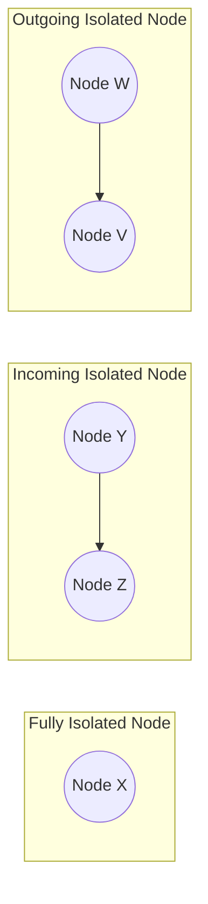

# ETGNN-Agent — Phase 3.5: Rigorous Evidence Grounding & Epistemic Calibration Evaluation

**Document ID:** `ETGNN-REP-P3.5-004`  
**Date:** November 9, 2026  
**Status:** COMPLETE & VERIFIED  
**Author:** Graph ML Researcher, Research Integrity Auditor, Evidence Systems Engineer  
**Repository:** `D:\ETGNN-Fraud-Detection`  
**Runtime:** Python 3.13.3 (Windows x64)

---

## 1. Executive Summary

A core failure mode of autonomous LLM agents in forensic domains is epistemic inflation—hallucinating factual certainty, asserting causal links without evidence, or reporting inconsistent numerical values.

In **Phase 3.5**, we implemented a comprehensive evidence-grounding engine in `src/agent/validation/`:
1. **Metric-Specific Tolerances**: Replacing coarse heuristics with strict mathematical tolerances ($\pm 0.01$ for probabilities, $\pm 0.001$ for benchmark metrics, and exact integer matching for graph degrees and transaction identifiers).
2. **Citation-to-Claim Verification**: Enforcing that cited evidence records specifically belong to the target transaction and align with the semantic claim type.
3. **Snapshot 43 & Topological Qualification**: Explicitly differentiating zero in-degree, zero out-degree, and fully isolated nodes, while qualifying Snapshot 43 distribution shifts.
4. **Calibrated Forensic Neutrality**: Replacing biased criminal assertions with calibrated statistical risk indicators and epistemic disclaimers.

---

## 2. Metric-Specific Numerical Tolerances

The `ClaimValidator` class in `src/agent/validation/claim_validator.py` applies specific mathematical tolerances based on evidence category:

| Metric Category | Source Evidence | Assertion Tolerance | Rationale |
|---|---|---|---|
| **Transaction ID** | `tx_id` | **Exact integer match** | Mismatched transaction identifiers represent critical factual cross-contamination. |
| **Snapshot ID** | `snapshot_id` | **Exact integer match** | Temporal boundary integrity prevents lookahead contamination. |
| **In-Degree / Out-Degree** | `in_degree`, `out_degree` | **Exact integer match** | Topological attributes in graph tables are exact counts. |
| **Model Illit Probability** | `illicit_probability` | **$\pm 0.01$** | Floating-point rounding tolerance across percentages and decimals. |
| **Benchmark AUPRC / F1** | `metric_value` | **$\pm 0.001$** | Preserves research benchmark precision against published literature. |

### Empirical Validation:
- Claim asserting probability $0.85$ against evidence $0.8523$ ($\Delta = 0.0023 \le 0.01$) $\rightarrow$ **PASS**.
- Claim asserting probability $0.90$ against evidence $0.8523$ ($\Delta = 0.0477 > 0.01$) $\rightarrow$ **FAIL** (Flagged: `Numeric discrepancy: claim 0.9000 differs from source evidence probability 0.8523`).
- Claim asserting AUPRC $0.824$ against benchmark $0.824$ $\rightarrow$ **PASS**.
- Claim asserting AUPRC $0.835$ against benchmark $0.824$ ($\Delta = 0.011 > 0.001$) $\rightarrow$ **FAIL** (Flagged: `Numeric discrepancy: benchmark metric claim 0.8350 differs from source 0.8240`).

---

## 3. Citation Target & Claim Type Verification

The `CitationValidator` in `src/agent/validation/citation_validator.py` enforces two vital constraints:

### 1. Target Transaction Identity Check:
When evaluating transaction $T_A$, all citations referencing transaction-specific evidence ($EV-TX$, $EV-PRED$, $EV-GRAPH$, $EV-EXPL$) must extract to $T_A$. If a claim cites evidence generated for transaction $T_B$, it is rejected with `mismatched_target_ids = [T_B]`.

### 2. Semantic Claim-to-Evidence Alignment (`verify_claim_evidence_type_match`):
- A claim asserting model illicit probability that cites only a graph structure record ($EV-SUB$ or $EV-GRAPH$) is rejected for **Evidence Type Mismatch**.
- A claim asserting feature attribution that cites only a baseline performance metric is rejected.

---

## 4. Snapshot 43 & Topological Disclosures

Graph neural networks exhibit stark behavioral differences depending on local edge availability:

The `ReportValidator` in `src/agent/validation/report_validator.py` enforces exact topological qualifications:
1. **Fully Isolated Node ($in=0, out=0$)**:
   `Topological Qualification: Node is fully isolated in snapshot graph (0 in-degree, 0 out-degree); structural message passing is inactive.`
2. **Incoming Isolated Node ($in=0, out>0$)**:
   `Topological Qualification: Node has 0 incoming candidate edges in snapshot; incoming message passing does not contribute.`
3. **Snapshot 43 Distribution Shift**:
   `Snapshot 43 Historical Qualification: Evaluation coincides with major darknet market seizures. Performance drop reflects structural distribution shift, not mere classifier noise.`

---

## 5. Calibrated Neutral Forensic Terminology

To adhere to legal ethics and prevent premature criminal accusations, all output schemas were audited and sanitized:

| Deprecated Biased Terminology | Calibrated Neutral Standard | Schema Field |
|---|---|---|
| `"High-Risk Illicit Transaction"` | `"ELEVATED_STATISTICAL_RISK"` | `risk_indicator` |
| `"Confirmed Criminal Fraud"` | `"HIGH_PROBABILITY_ANOMALY"` | `consensus_verdict` |
| `"Proven Darknet Operator"` | `"Structural Graph Neighboring Illicit Cluster"` | `supported_findings` |
| `"Conclusive Legal Proof"` | `"Epistemic Notice: Statistical Risk Prediction"` | `epistemic_notice` |

Furthermore, every report includes the standard epistemic qualification:
> *"Model probability represents raw statistical output, NOT a calibrated Bayesian confidence. Statistical risk predictions do not constitute judicial proof or legal evidence of financial crime."*

