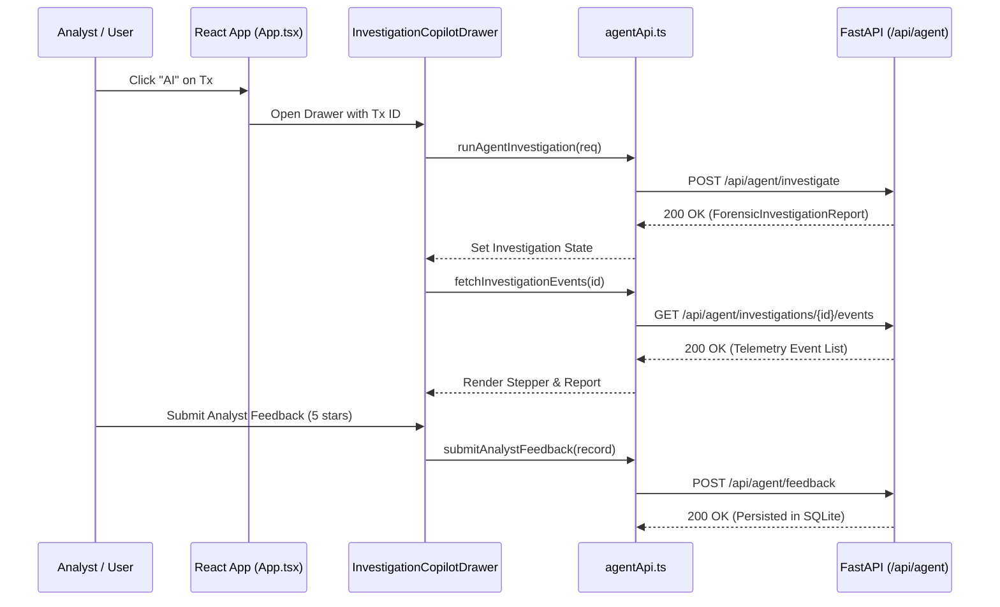

# ETGNN-Agent — Phase 4: Frontend Agent Architecture
## Technical Design, State Management & Component Hierarchy

**Component Path:** `web/frontend/src/components/agent/`  
**Framework:** React 19, TypeScript 5, Vite  
**Styling Paradigm:** CSS Custom Properties / Design System Tokens (`index.css`)  

---

## 1. Architectural Principles

1. **Integrated In-Place Copilot**: Rather than forcing analysts into a separate web application, the Copilot is architected as an ambient slide-out drawer (`InvestigationCopilotDrawer`) that maintains analytical context while allowing side-by-side transaction inspection.
2. **Deterministic Evidence Grounding**: The frontend visualizes claims with explicit references to the underlying `EvidenceRecord` IDs. Uncited claims or ungrounded generative assertions are prevented by contract.
3. **Provider Mode Transparency**: The UI prominently displays whether a report was generated by `LIVE` LLM, `SIMULATED` (deterministic offline mock), or `DETERMINISTIC_EVIDENCE_ONLY` (non-generative factual extraction).
4. **Resilient Communication**: All backend API interactions are encapsulated in `src/services/agentApi.ts` with strongly-typed interfaces, error boundary protection, and loading state management.

---

## 2. Component Hierarchy

```
App.tsx
 ├── Header
 │    └── "Investigate with AI" Drawer Trigger
 ├── TabNavigation
 │    └── "AI Copilot" Tab
 ├── TransactionExplorer
 │    └── Row Actions: "AI" Button (Triggers Drawer with Tx ID)
 ├── PredictionArena
 │    └── "Investigate with Copilot" Action Button
 ├── SubgraphVisualizer / ExplanationInspector
 │    └── Deep Link Return Handlers
 └── InvestigationCopilotDrawer (Master Drawer Container)
      ├── DrawerHeader (Tx Selector, Mode Switcher, Provider Selector, Esc Handlers)
      ├── InvestigationWorkflowStepper (8-Stage Execution Telemetry)
      ├── TabStrip (Report, Evidence, Follow-up Chat, Feedback, History)
      └── Tab Panels:
           ├── Tab: Report
           │    ├── ModelComparisonPanel (ETGNN vs RF vs XGBoost + Spread Warning)
           │    ├── InteractiveGraphEvidenceViewer (Snapshot 43 Badge + Degree Breakdown)
           │    └── InvestigationReportViewer (Executive Summary, Structured Findings)
           ├── Tab: Evidence
           │    └── EvidenceExplorer (Provenance Chain, Graph Records, Citations)
           ├── Tab: Chat
           │    └── InvestigationChat (Follow-up Q&A, Suggested Chips, Citation Badges)
           ├── Tab: Feedback
           │    └── AnalystFeedbackForm (Rating, Review Category, SQLite Persistence)
           └── Tab: History
                └── InvestigationHistory (Cached Sessions, Quick Re-open)
```

---

## 3. Data Flow & State Lifecycle



---

## 4. Key TypeScript Types (`src/types/agent.ts`)

- `ForensicInvestigationReport`: Complete investigation schema containing consensus verdict, model predictions, graph evidence summary, GNNExplainer summary, supported findings, limitations, and provenance chain.
- `AgentInvestigationEvent`: Telemetry event emitted by LangGraph nodes (`INITIALIZE`, `MODEL_PREDICTION`, `GRAPH_RETRIEVAL`, `EXPLAINER_RETRIEVAL`, `RESEARCH_SYNTHESIS`, `SAFETY_VALIDATION`, `REPORT_GENERATION`).
- `FeedbackSubmission` / `FeedbackRecord`: Human-in-the-loop analyst feedback structure.
- `ChatMessage`: Conversational message type binding chat responses to cited evidence records.

