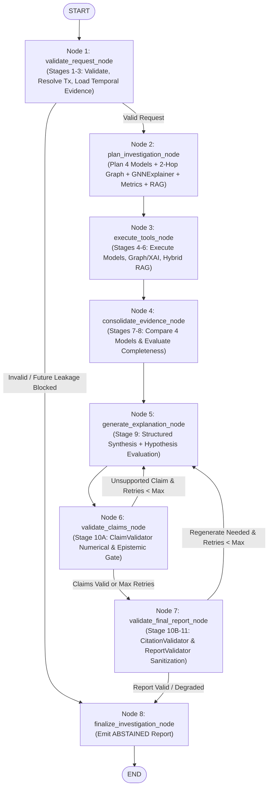

# ETGNN-Agent — Phase 5 Advanced Agentic AI & Hybrid Graph-RAG Architecture

**Project:** ETGNN-Agent — Evidence-Grounded Agentic AI for Explainable Bitcoin Transaction Fraud Detection  
**Phase:** 5 — Advanced Agentic AI Implementation  
**Repository:** `D:\ETGNN-Fraud-Detection`  
**Orchestration Engine:** Official LangGraph (`langgraph.graph.StateGraph` / `CompiledStateGraph`)

---

## 1. Architectural Overview

ETGNN-Agent Phase 5 implements a bounded, deterministic, multi-step forensic investigation state machine that combines:
1. **Multi-Model Graph & Tabular Inference**: `ETGNN` (Canonical Temporal GNN), `Matched GAT` (Static Graph Attention), `Random Forest`, and `XGBoost`.
2. **Topological & XAI Analysis**: Directed 2-hop snapshot subgraph extraction (`get_transaction_neighbors`) and `GNNExplainer` representation sensitivity attribution (`get_explanation`).
3. **Hybrid Reranked Graph-RAG**: Dense TF-IDF L2 cosine similarity (`0.50`), normalized lexical keyword overlap (`0.30`), source authority tier weighting (`0.15`), and metadata-aware reranking boosts (`+0.05` to `+0.18`) with deterministic `content_hash` (SHA-256) provenance and untrusted evidence directive sanitization.
4. **Triple-Gate Validation & Epistemic Calibration**: `CitationValidator`, `ClaimValidator`, and `ReportValidator` enforce metric-specific numerical tolerances (`±0.01` probabilities, `±0.001` benchmark metrics), exact degree matching, Snapshot 43 non-causal qualification, and structured hypothesis classifications (`SUPPORTED`, `PARTIALLY_SUPPORTED`, `UNSUPPORTED`, `NOT_TESTABLE`).

---

## 2. 11-Stage Multi-Step Investigation Workflow

Every completed investigation tracks and emits 11 explicit workflow stages in `workflow_stages_completed`:

| Stage ID | Stage Name | Responsibility | Module |
|---|---|---|---|
| `STAGE_1_VALIDATE_REQUEST` | Validate Investigation Request | Sanitizes prompt injection patterns and validates parameters | `src/agent/orchestration/nodes.py` |
| `STAGE_2_RESOLVE_TRANSACTION` | Resolve Bitcoin Transaction ID | Resolves `tx_id` against the 203,769-node Elliptic index | `src/agent/tools/investigation_tools.py` |
| `STAGE_3_LOAD_TEMPORAL_EVIDENCE` | Load Temporally Permitted Evidence | Enforces `as_of_snapshot` and masks held-out labels (`Test 41–49`) | `src/agent/tools/investigation_tools.py` |
| `STAGE_4_EXECUTE_MODELS` | Execute Fraud Prediction Models | Runs `etgnn`, `matched_gat`, `random_forest`, and `xgboost` | `src/agent/tools/investigation_tools.py` |
| `STAGE_5_ANALYZE_GRAPH_XAI` | Analyze Graph & XAI Artifacts | Extracts 2-hop directed subgraph and `GNNExplainer` attributions | `src/agent/tools/investigation_tools.py` |
| `STAGE_6_RETRIEVE_RAG_EVIDENCE` | Retrieve Verified Research Evidence | Hybrid semantic + lexical + metadata-reranked Graph-RAG retrieval | `src/agent/rag/retriever.py` |
| `STAGE_7_COMPARE_MODELS` | Compare Predictions Across Models | Computes 4-model probability spread and divergence flag (`spread >= 0.30`) | `src/agent/orchestration/nodes.py` |
| `STAGE_8_EVALUATE_EVIDENCE_COMPLETENESS` | Evaluate Evidence Completeness | Classifies state as `COMPLETE`, `PARTIAL_RESULT`, or `EVIDENCE_INSUFFICIENT` | `src/agent/orchestration/nodes.py` |
| `STAGE_9_GENERATE_EXPLANATION` | Generate Grounded Explanation | Synthesizes findings, limitations, and `HypothesisEvaluation` records | `src/agent/llm/provider.py` |
| `STAGE_10_VALIDATE_CLAIMS_CITATIONS` | Validate Claims & Citations | Verifies numerical tolerances, degree counts, and provenance IDs | `src/agent/validation/` |
| `STAGE_11_PRODUCE_REPORT` | Produce Structured Report | Emits schema-validated `ForensicInvestigationReport` + SHA-256 hash | `src/agent/reports/report_builder.py` |

---

## 3. Authoritative Temporal Split & Leakage Prevention

Consistent with `src/data/create_masks.py` and `data/processed/nodes_with_masks.csv`:
- **Train Split**: Snapshots `1–32` (`train_mask`, `training_cutoff_step = 32`)
- **Validation Split**: Snapshots `33–40` (`val_mask`)
- **Test Split**: Snapshots `41–49` (`test_mask`, 9,973 labelled test transactions)

In `HISTORICAL_EVALUATION` mode:
1. Any transaction or neighbor with `snapshot_id > as_of_snapshot` raises `TemporalBoundaryViolationError` (`TEMPORAL_LEAKAGE_BLOCKED`).
2. Ground-truth labels for test-split transactions (`split == "test"`, `snapshot_id >= 41`) and post-cutoff snapshots (`as_of_snapshot <= 32` and `snapshot_id >= 33`) are restricted (`LabelStatus.RESTRICTED`, `raw_label_code = None`).
3. Neighbor ground-truth label counts in `get_transaction_neighbors` mask test-split neighbors (`n_step >= 41`).

