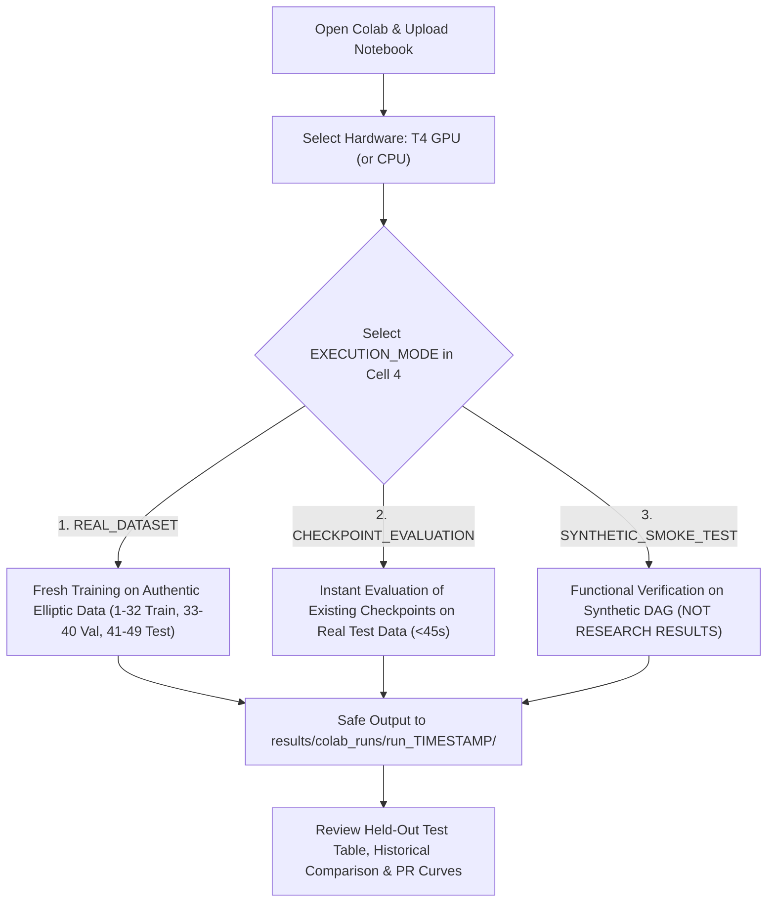

# ETGNN End-to-End Training & Baseline Benchmark
## Google Colab Execution and Supervisor Review Guide

**Document ID:** `notebooks/COLAB_EXECUTION_GUIDE.md`  
**Notebook File:** [`notebooks/ETGNN_End_to_End_Training_and_Benchmark.ipynb`](file:///d:/ETGNN-Fraud-Detection/notebooks/ETGNN_End_to_End_Training_and_Benchmark.ipynb)  
**Research Title:** *Explainable Temporal Graph Neural Networks for Adaptive Financial Fraud Detection*  
**Repository:** `D:\ETGNN-Fraud-Detection`  
**Author:** Honours Research Candidate  
**Date:** November 2026  

---

## 1. Quickstart & Workflow Overview

This notebook is an academic, reproducible benchmark suite designed for Google Colab. It trains, validates, tests, and compares all 7 primary fraud detection models using the **authentic Elliptic Bitcoin Dataset**.



---

## 2. The Three Explicit Execution Modes

Configure `EXECUTION_MODE` in **Cell 4**:

```python
# =====================================================================
# Options:
#   1. "REAL_DATASET"          - Full training on authentic Elliptic data
#   2. "CHECKPOINT_EVALUATION" - Instant evaluation of existing checkpoints
#   3. "SYNTHETIC_SMOKE_TEST"  - Quick functional smoke test (NOT RESEARCH RESULTS)
# =====================================================================
EXECUTION_MODE = "REAL_DATASET"
```

| Execution Mode | Dataset Used | What It Executes | Expected Runtime | Output Designation |
|:---|:---|:---|:---:|:---:|
| **`REAL_DATASET`** | **Authentic Elliptic** (203k nodes, 234k edges) | Trains Random Forest, XGBoost, GCN, GraphSAGE, GAT, Matched GAT, and ETGNN from scratch. Applies early stopping on validation AUPRC. Saves checkpoints to a new timestamped folder. | $\sim 5\text{--}8$ min (T4 GPU)<br>$\sim 15$ min (CPU) | **OFFICIAL RESEARCH RESULTS** |
| **`CHECKPOINT_EVALUATION`** | **Authentic Elliptic** (203k nodes, 234k edges) | Loads pre-trained model weights from `results/checkpoints/` and evaluates test set metrics (steps 41–49) immediately. | $< 45$ seconds | **OFFICIAL CHECKPOINT EVALUATION** |
| **`SYNTHETIC_SMOKE_TEST`** | **Synthetic DAG** (1,200 nodes, 49 steps) | Fast functional test verifying all forward/backward passes and plotting routines without needing data files. | $< 30$ seconds | **NOT RESEARCH RESULTS (SMOKE TEST ONLY)** |

> [!CAUTION]
> **Zero Silent Fallback Rule:** If `REAL_DATASET` or `CHECKPOINT_EVALUATION` is selected and any of the 5 required dataset files are missing, the notebook **immediately stops with a descriptive `FileNotFoundError`**. It will **never** silently fall back to synthetic data during research evaluation.

---

## 3. Real Dataset Setup for Google Colab

The authentic Elliptic dataset consists of 5 processed files totaling $\sim 490$ MB:
- `train_graph.pt` (92 MB)
- `validation_graph.pt` (114 MB)
- `test_graph.pt` (143 MB)
- `scaled_features.npy` (134 MB)
- `nodes_with_masks.csv` (8 MB)

### Option A: Uploading to Google Drive (Recommended)
1. In Google Drive, create a folder: `My Drive/ETGNN-Fraud-Detection/data/processed/`.
2. Upload the 5 files above into this folder.
3. In **Cell 2** of the notebook, set:
   ```python
   MOUNT_GOOGLE_DRIVE = True
   ```
4. Run the notebook. It automatically discovers Drive at `/content/drive/MyDrive/ETGNN-Fraud-Detection/data/processed`.

### Option B: Direct Colab File Upload (Temporary Session)
1. In Colab, click the **Files (folder icon)** on the left sidebar.
2. Create a folder named `data/processed`.
3. Upload the 5 files into `data/processed/`.
4. Leave `MOUNT_GOOGLE_DRIVE = False`. The notebook will automatically find `./data/processed`.

---

## 4. Safe Checkpoint Preservation

To ensure strict scientific integrity:
- **Existing research checkpoints in `results/checkpoints/` are NEVER overwritten.**
- Fresh training runs automatically save their models, metrics, and figures into an isolated timestamped directory:
  ```
  results/colab_runs/run_YYYYMMDD_HHMMSS/
  ├── checkpoints/
  │   ├── etgnn.pt
  │   ├── gat.pt
  │   ├── gcn.pt
  │   ├── graphsage.pt
  │   ├── matched_gat.pt
  │   ├── random_forest.joblib
  │   └── xgboost.json
  └── tables/
      ├── final_test_results_colab.csv
      ├── colab_test_probabilities.npz
      ├── colab_benchmark_pr_curves.png
      └── COLAB_BENCHMARK_SUMMARY.md
  ```

---

## 5. Model Implementations & Verification

All 7 models strictly match the underlying repository definitions:

| # | Model Name | Model Family | Key Hyperparameters | Trainable Parameters | Repository Source Script |
|:---:|:---|:---|:---|:---:|:---|
| **1** | **Random Forest** | Tabular Baseline | 100 trees, `max_depth=12`, `class_weight='balanced_subsample'` | N/A | [`train_random_forest.py`](file:///d:/ETGNN-Fraud-Detection/src/training/train_random_forest.py) |
| **2** | **XGBoost** | Gradient Boosting | 300 trees, `max_depth=5`, `lr=0.05`, `scale_pos_weight=13.06`, `hist` | N/A | [`train_xgboost.py`](file:///d:/ETGNN-Fraud-Detection/src/training/train_xgboost.py) |
| **3** | **GCN** | Spectral GNN | 2-layer `GCNConv(165, 64) -> ReLU -> Dropout(0.3) -> GCNConv(64, 2)` | **10,754** | [`src/models/gcn.py`](file:///d:/ETGNN-Fraud-Detection/src/models/gcn.py) |
| **4** | **GraphSAGE** | Spatial GNN | 2-layer `SAGEConv(165, 64) -> ReLU -> Dropout(0.3) -> SAGEConv(64, 2)` | **21,442** | [`src/models/graphsage.py`](file:///d:/ETGNN-Fraud-Detection/src/models/graphsage.py) |
| **5** | **GAT** | Graph Attention | 2-layer `GATConv(165, 16, heads=4) -> ReLU -> Dropout(0.3) -> GATConv(64, 2)` | **10,886** | [`src/models/gat.py`](file:///d:/ETGNN-Fraud-Detection/src/models/gat.py) |
| **6** | **Matched GAT** | Negative Control | 2-layer GAT with 16-dim all-zero time vector ($\mathbf{0} \in \mathbb{R}^{16}$) | **11,910** | [`src/models/matched_gat.py`](file:///d:/ETGNN-Fraud-Detection/src/models/matched_gat.py) |
| **7** | **Proposed ETGNN** | Temporal GAT | 2-layer GAT with 16-dim Vaswani sinusoidal time encoding $PE(t) \in \mathbb{R}^{16}$ | **11,910** | [`src/models/etgnn.py`](file:///d:/ETGNN-Fraud-Detection/src/models/etgnn.py) |

> [!NOTE]
> **Controlled Parameter Matching:** Notice that **Matched GAT** and **ETGNN** possess **exactly 11,910 parameters**. This controls for architectural capacity, ensuring any performance difference is strictly attributable to the temporal encoding.

---

## 6. Historical Benchmark Comparison Table

In **Cell 16**, the notebook outputs a side-by-side comparison against the official repository test results:

| Model | Historical Reference AUPRC | Expected Behavior in Fresh Run |
|:---|:---:|:---|
| **Random Forest** | **0.6323** | Highly deterministic ($0.632 \pm 0.005$) |
| **XGBoost** | **0.5472** | Highly deterministic ($0.547 \pm 0.005$) |
| **GraphSAGE** | **0.2427** | Normal GPU variance ($\sim 0.22\text{--}0.26$) |
| **Proposed ETGNN** | **0.2250** | Normal GPU variance ($\sim 0.21\text{--}0.24$) |
| **Matched GAT** | **0.2099** | Normal GPU variance ($\sim 0.20\text{--}0.23$) |
| **GCN** | **0.1306** | Normal GPU variance ($\sim 0.12\text{--}0.15$) |
| **GAT** | **0.1155** | Normal GPU variance ($\sim 0.10\text{--}0.13$) |

### Sources of Expected Variances:
1. **PyTorch / CUDA Non-Determinism:** Sparse graph message passing (`torch_geometric`) utilizes non-deterministic atomic operations on CUDA GPUs during scatter/gather operations.
2. **Library Version Differences:** Newer versions of Scikit-learn or XGBoost in Colab may introduce minor numeric variations in tree splits.
3. **Imbalanced Validation Early Stopping:** Validation AUPRC fluctuates slightly between epochs; early stopping may trigger $\pm 1\text{--}2$ epochs earlier or later.

---

## 7. Supervisor & Examiner Defense FAQ

### Q1: Why does Random Forest (0.6323) beat all Graph Neural Networks (0.1155–0.2427)?
**Defense:**
1. **Engineered Neighbourhood Features:** In the Elliptic dataset, 72 of the 165 features are already precomputed 1-hop aggregations (e.g. mean, std, min, max of transacted amounts). Tabular models exploit these non-linear statistics directly without suffering from graph structural noise.
2. **Intra-Step Only Topology:** All transaction edges in Elliptic are strictly intra-step ($\Delta t = 0$). Graph neural networks propagate messages indiscriminately across thousands of unlabelled nodes, which dilutes illicit signal.
3. **Empirical Negative Result:** This is an important, scientifically defensible empirical finding that mirrors findings in top graph ML literature (e.g., *Errica et al., ICLR 2020*; *Platonov et al., NeurIPS 2023*). Acknowledging tabular dominance reflects strong academic integrity.

### Q2: Did temporal encoding help ETGNN?
**Defense:**
Yes, slightly. When comparing **ETGNN (0.2250 AUPRC)** against the exact **Parameter-Matched Zero-Time GAT (0.2099 AUPRC)**, ETGNN achieves higher precision (0.2614 vs. 0.1205) and higher AUPRC (+0.0151). However, the difference is modest and structural attention remains the primary mechanism.

### Q3: How is data leakage prevented in this pipeline?
**Defense:**
1. **Chronological Splitting:** Training nodes belong strictly to time steps 1–32; validation to steps 33–40; test to steps 41–49.
2. **Train-Only Preprocessing:** The `StandardScaler` was fitted strictly on training data ($t \le 32$) and applied forward without updating.
3. **Unlabelled Masking:** Unknown transactions (label `-1`) participate only in graph message passing and are strictly excluded from loss computation and metric scoring.
