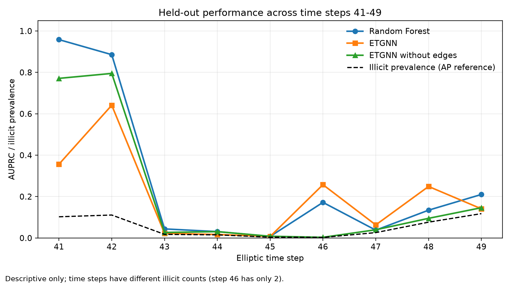
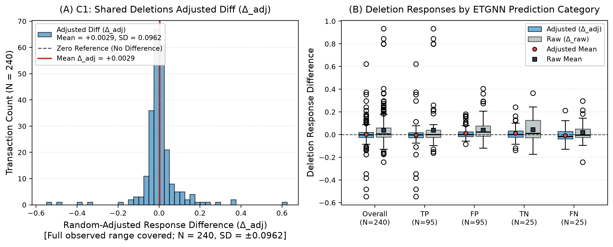
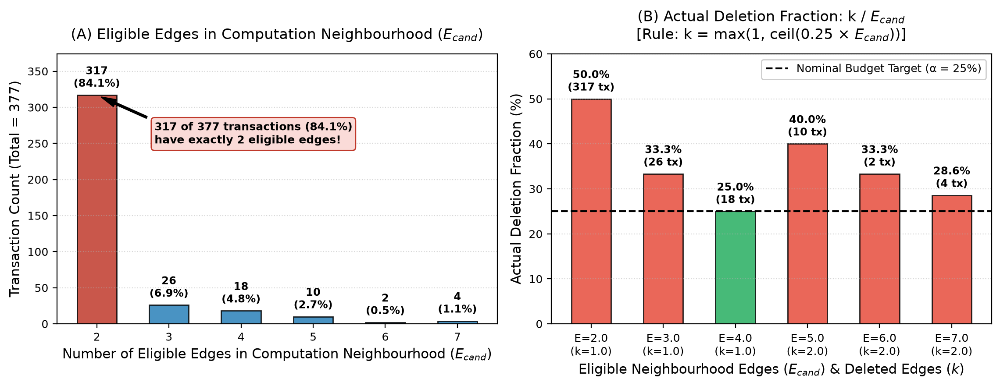
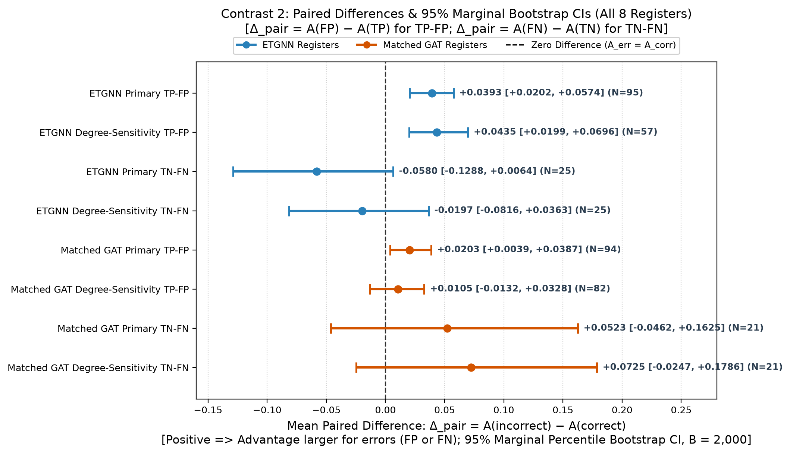
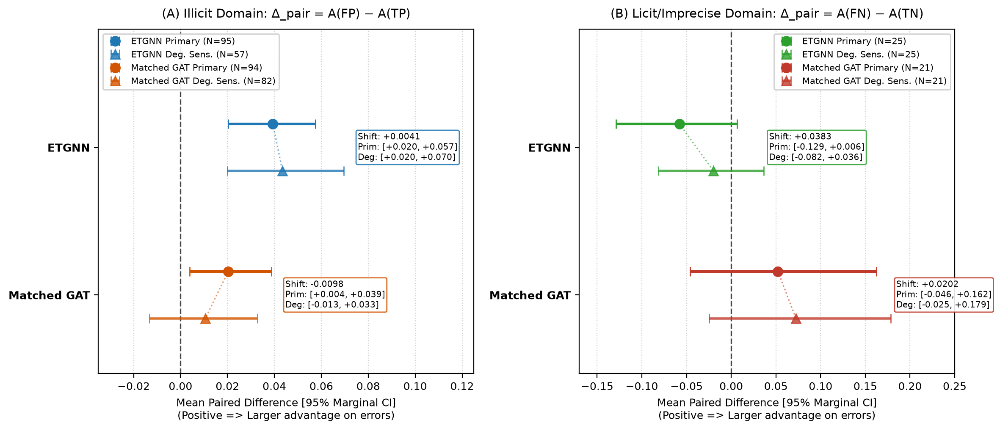

# Results, Discussion, and Conclusion

## Evaluation setting

The Elliptic Bitcoin transaction dataset was split chronologically:
time steps 1-32 for training, 33-40 for validation, and 41-49 for
testing. Only transactions labelled licit or illicit were
included in supervised evaluation. The test set contained 9,973
labelled transactions, including 524 illicit transactions (5.25%).
AUPRC was the primary metric because illicit transactions are the
minority class. F1 results use a fixed threshold of 0.5. Test period
labels were previously inspected during preliminary research stages.

## Model comparison

| Model | Precision | Recall | F1 | ROC-AUC | AUPRC |
|---|---:|---:|---:|---:|---:|
| Random Forest | 0.6966 | 0.5782 | 0.6319 | 0.8735 | 0.6323 |
| XGBoost | 0.2823 | 0.6050 | 0.3849 | 0.8074 | 0.5472 |
| GCN | 0.1009 | 0.8645 | 0.1808 | 0.7732 | 0.1306 |
| GraphSAGE | 0.1238 | 0.7481 | 0.2125 | 0.8205 | 0.2427 |
| GAT | 0.0893 | 0.9141 | 0.1627 | 0.7548 | 0.1155 |
| ETGNN | 0.2614 | 0.4504 | 0.3308 | 0.8062 | 0.2250 |

Random Forest achieved the highest held-out AUPRC (0.6323). The
proposed ETGNN achieved 0.2250 and therefore did not outperform the
strongest baseline. ETGNN exceeded the tested GAT configuration
(0.1155), although the matched zero-time GAT reached 0.2099; the
held-out difference between ETGNN and this matched control was small.
These results do not support a general claim that the proposed
temporal graph model is superior for illicit transaction detection.

## Feature and edge ablations

The released feature set contains 93 local numeric features after
separating the time step, followed by 72 precomputed one-hop
neighborhood aggregates. Consequently, the full-feature Random
Forest already receives some graph-derived information. Its
local-feature-only version still achieved test AUPRC 0.6301, close
to the full-feature result of 0.6323. Adding sinusoidal time features
to Random Forest produced AUPRC 0.6295.

ETGNN using local features achieved AUPRC 0.2344. With the same
local features and time encoding but no graph edges, AUPRC rose to
0.4812. This one-run edge ablation shows that the implemented
message-passing configuration did not improve AUPRC on the held-out
period. It does not identify the reason for the difference.

## Variation across time

Figure 1 plots AUPRC by test time step alongside illicit prevalence.
Random Forest performed strongly at steps 41 and 42, but performance
was much lower at several later steps. The illicit proportion also
changed substantially over the period. Per-step AUPRC is sensitive
to the number of positive cases: step 46 contains only two illicit
transactions, so its score should not be interpreted in isolation.
Temporal variation is visible, but these observations alone do not
establish the cause of the validation-to-test performance decline.

## Explainability and Intervention Analysis (C1 & C2 Benchmark)

To investigate model behavior beyond single illustrative examples, a frozen
multi-register benchmark was conducted across 377 completed validation
transactions from time steps 37–40 (following initial development on steps 33–36).
Both models underwent runtime subgraph probability equivalence assertions.

### Subgraph Forward-Pass Equivalence Coverage
During the main benchmark execution, runtime assertions enforced that 2-hop
computation subgraph forward passes reproduced full-graph prediction probabilities
within a tolerance of $10^{-5}$ on all 377 completed nodes for both ETGNN and
Matched GAT. An additional stratified verification across candidate neighborhood
sizes ($E_{cand} \in \{2, 3, 4, 5, 6, 7\}$) observed discrepancies bounded by
$3.58 \times 10^{-7}$ (ETGNN) and $8.94 \times 10^{-8}$ (Matched GAT) within that
tested sample.

### Contrast 1: Random-Adjusted Response Difference to Shared Deletions
Contrast 1 (C1) evaluates whether ETGNN and Matched GAT differ in their response
when subjected to the identical deletion of top edges selected by GNNExplainer on
ETGNN under identical budgets across 240 validation transactions (steps 37–40).
For each model $M$, the explainer advantage over a random edge-deletion comparator is:
$$\text{Adv}_{M}(i) = \Delta_{GE, M}(i) - \frac{1}{30}\sum_{d=1}^{30}\Delta_{Rnd, M}^{(d)}(i)$$
where random deletion serves as a baseline comparator rather than pure noise.
The primary C1 estimator is the adjusted difference:
$$\Delta_{adj}(i) = \text{Adv}_{ETGNN}(i) - \text{Adv}_{Matched\_GAT}(i)$$
with unadjusted raw drop difference $\Delta_{raw}(i) = \Delta_{GE, ETGNN}(i) - \Delta_{GE, Matched\_GAT}(i)$
as a secondary diagnostic.

Empirically, across the $N = 240$ C1 transactions, the observed mean random-adjusted
response difference was small in this selected sample of frozen checkpoints:
$\text{mean } \Delta_{adj} = 0.002903$ (with sample standard deviation $s = \pm 0.096180$
across transactions, median = $-0.001534$, $\text{IQR} = 0.063236$). The raw difference
had $\text{mean } \Delta_{raw} = 0.038491$ ($s = \pm 0.139170$, median = $0.006023$).
The sample mean advantage over random deletion was $0.020239$ for ETGNN and $0.017336$
for Matched GAT. These findings do not imply that the models are functionally identical,
nor do they demonstrate a causal time-encoding effect. Any additional bootstrap interval
on C1 must be explicitly designated as exploratory.

### Candidate Edges and Deletion Budget Rule
The frozen deletion protocol enforced the discrete ceiling rule:
$$k = \max(1, \lceil 0.25 \times E_{cand} \rceil)$$
where $E_{cand}$ denotes the count of eligible edges in the defined 2-hop computation neighbourhood.
Because $E_{cand}$ is small across the network, the actual deletion fraction $k / E_{cand}$ diverges
substantially from the nominal 25% target:
- $E_{cand} = 2$ ($N = 317$, 84.1% of transactions): $k = \max(1, \lceil 0.50 \rceil) = 1 \implies$ actual deletion fraction is **50.0%** (a 2.0× inflation over nominal 25%).
- $E_{cand} = 3$ ($N = 26$, 6.9%): $k = \max(1, \lceil 0.75 \rceil) = 1 \implies$ actual deletion fraction is **33.3%**.
- $E_{cand} = 4$ ($N = 18$, 4.8%): $k = \max(1, \lceil 1.00 \rceil) = 1 \implies$ actual deletion fraction is **25.0%**.
- $E_{cand} = 5$ ($N = 10$, 2.7%): $k = \max(1, \lceil 1.25 \rceil) = 2 \implies$ actual deletion fraction is **40.0%**.
- $E_{cand} = 6$ ($N = 2$, 0.5%): $k = \max(1, \lceil 1.50 \rceil) = 2 \implies$ actual deletion fraction is **33.3%**.
- $E_{cand} = 7$ ($N = 4$, 1.1%): $k = \max(1, \lceil 1.75 \rceil) = 2 \implies$ actual deletion fraction is **28.6%**.

All 377 transactions in the saved records strictly match this ceiling rule without exception.
Across all transactions, the sample mean actual deletion fraction was $47.08\%$ (median $50.0\%$).
Perturbation magnitudes therefore reflect discrete structural edge removals on sparse local subgraphs.

### Contrast 2: Matched-Pair Bootstrap Across All Eight Registers
Contrast 2 (C2) assesses whether GNNExplainer masks yield larger deletion responses
on erroneous classifications than on correct classifications within each model.
The implemented paired difference contrast is defined as:
$$\Delta_{pair} = A(\text{incorrect}) - A(\text{correct})$$
Specifically:
- For FP–TP pairs: $\Delta_{pair} = A(\text{FP}) - A(\text{TP})$
- For TN–FN pairs: $\Delta_{pair} = A(\text{FN}) - A(\text{TN})$

#### Worked Pair Example from Saved Records
In pair `ETGNN_full_TP_FP_001`:
- Treat Node: $u = 148295$ (FP, time step 37). Explainer drop = $-0.013590$, mean random drop = $0.020087 \implies A(\text{FP}) = -0.013590 - 0.020087 = -0.033677$.
- Control Node: $v = 152012$ (TP, time step 38). Explainer drop = $+0.046399$, mean random drop = $0.023608 \implies A(\text{TP}) = 0.046399 - 0.023608 = +0.022791$.
- Paired Difference: $\Delta_{pair} = A(\text{FP}) - A(\text{TP}) = -0.033677 - (+0.022791) = -0.056467$.

Across the matched registers, pairs were resampled using matched-pair bootstrap ($B = 2,000$ iterations,
seed `20261020`). Preserving pairs in the bootstrap accounts for correlation within matched pairs,
but does not account for dependence between different pairs sharing overlapping graph context.
All eight confidence intervals are marginal and unadjusted for multiple testing.

| Register | Match Type | Pairs ($N$) | Mean Paired Diff | Bootstrap SE | 95% Marginal CI | Zero Crossed? |
|---|---|---:|---:|---:|---:|:---:|
| ETGNN Primary TP–FP | Primary | 95 | +0.039343 | 0.009585 | [+0.020234, +0.057410] | No |
| ETGNN Degree-Sensitivity TP–FP | Degree | 57 | +0.043455 | 0.012658 | [+0.019882, +0.069552] | No |
| Matched GAT Primary TP–FP | Primary | 94 | +0.020315 | 0.008923 | [+0.003917, +0.038684] | No |
| Matched GAT Degree-Sensitivity TP–FP | Degree | 82 | +0.010547 | 0.011610 | [-0.013240, +0.032770] | **Yes** |
| ETGNN Primary TN–FN | Primary | 25 | -0.058027 | 0.034398 | [-0.128831, +0.006393] | **Yes** |
| ETGNN Degree-Sensitivity TN–FN | Degree | 25 | -0.019748 | 0.029750 | [-0.081593, +0.036312] | **Yes** |
| Matched GAT Primary TN–FN | Primary | 21 | +0.052255 | 0.051517 | [-0.046153, +0.162460] | **Yes** |
| Matched GAT Degree-Sensitivity TN–FN | Degree | 21 | +0.072489 | 0.051881 | [-0.024721, +0.178587] | **Yes** |

#### Empirical Interpretations:
1. **Direction of ETGNN FP–TP Difference:**
   Within the matched sample, the explanation-minus-random deletion response was **larger for false positives than true positives**
   ($\text{mean } A(\text{FP}) - A(\text{TP}) = +0.039343$ in primary matching, $+0.043455$ in degree-sensitivity matching).
   Neither interval crosses zero. This indicates that top-mask deletions reduced predicted-class probabilities more
   sharply for false positives than for true positives. This empirical pattern must not be described as proof of
   explanation quality, identification of harmful edges, or successful error correction.
2. **Matching Specification Sensitivity in Matched GAT:**
   In Matched GAT, primary caliper matching yielded a positive estimate ($+0.020315$, 95% CI $[+0.003917, +0.038684]$),
   whereas in the degree-sensitivity sample the estimate attenuated to $+0.010547$ with its 95% CI crossing zero
   ($[-0.013240, +0.032770]$; $-0.013240$ is the lower bound of the CI, not the mean). Because the primary and
   degree-sensitivity registers represent different, overlapping matched samples, changes between estimates cannot
   be attributed solely to degree adjustment, nor does the difference in zero-crossing status establish that the
   two models differ significantly from each other.
3. **Statistical Imprecision in False Negative (FN) Comparisons:**
   In all four TN–FN registers, the 95% bootstrap confidence intervals are wide and span zero. This pervasive
   imprecision stems from the small number of false negative transactions available in the validation window
   ($N = 25$ for ETGNN and $N = 21$ for Matched GAT). Crucially, non-significance reflects sample-size limitations
   and must not be interpreted as evidence of functional equality between TN and FN explanations.

---

## Limitations

1. **Previously Used Validation Data:** The 377 transactions evaluated in C1 and C2 were sampled from the
   chronological validation period (steps 37–40, following steps 33–36 used for development), where model checkpoints
   and thresholds were selected. Furthermore, historical test split performance (steps 41–49) was previously inspected.
   These evaluations are structured follow-up audits, not uninspected prospective trials.
2. **Single Checkpoint per Model:** All explanations and perturbations evaluated a single frozen checkpoint per
   architecture, conflating inductive bias with checkpoint-specific stochasticity.
3. **Fixed Precomputed Aggregate Features:** 72 of the 165 node features are precomputed neighborhood aggregates.
   Deleting graph edges perturbs runtime message passing but leaves tabular neighborhood aggregates static.
4. **Graph Dependence:** Transactions reside within a connected transaction graph. Although matched-pair bootstrap
   preserves pair-level correlation, it does not account for dependence between different pairs sharing graph context.
5. **Multiplicity:** The eight bootstrap intervals are marginal estimates and are not adjusted for multiple comparisons.
6. **No Causal Error Correction:** Deletion perturbations measure model sensitivity under edge omission; they do not
   demonstrate causal error correction, explanation faithfulness, or ground-truth explanation validity. Non-significant
   differences must not be conflated with equivalence.

---

## Conclusion

The principal hypothesis was not supported. Random Forest achieved AUPRC 0.6323, while ETGNN achieved 0.2250.
Ablations showed that a no-edge local ETGNN reached 0.4812, indicating that the implemented message passing
did not provide an advantage on the held-out period.

In post-hoc explanation audits, C1 random-adjusted deletion responses showed a small observed mean difference between
ETGNN and Matched GAT ($+0.002903$). In Contrast 2, within the matched sample, the explanation-minus-random deletion
response was larger for false positives than true positives for ETGNN across both primary and degree-sensitivity samples,
while Matched GAT estimates were sensitive to the matching sample, and FN comparisons remained statistically imprecise.
Due to sparse local neighbourhoods ($84.1\%$ having $E_{cand} = 2$), discrete ceiling deletion rules imposed an actual
$50\%$ deletion fraction rather than the nominal $25\%$.
